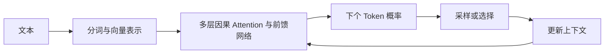

# 模块 01：大模型基础原理（6 个复习单元）

[返回目录](../README.md) · 来源：全部为补充复习，原课标题和正文未取回。

## 01.1 Token 与自回归生成

Token 是分词器输出的离散单元，可能是字、子词、标点或字节组合，不等于一个汉字。模型把上下文转为 Token 序列，每次估计下一个 Token 的概率，再将新 Token 加入序列。完整回答是多次预测的结果，不是从数据库拿出预存答案。

条件概率可记为 `P(文本) = ∏ P(当前 token | 前面的 token)`。这解释了错误为什么可能累积：前面生成的错误内容也会成为后续条件。

工程注意：字符数不能直接代替 Token 数；切片、成本、输入预算应使用目标模型对应的分词规则。生成流的分片也不一定正好对应一个 Token。

自测：为什么同样长度的中文、英文、代码，调用成本可能不同？

## 01.2 Embedding 与语义表示

Embedding 把离散对象映射为向量。生成模型内部的 Token 表示，与用于语义检索的文本向量，是相关但不同的用途；不能随便取某层隐状态就当作高质量检索模型。

检索时，查询和文档要放进兼容的向量空间，才有可解释的距离比较。余弦相似度衡量方向接近程度，不是“答案正确概率”。语义相似也不等于业务条件一致，例如“可以退款”与“不可以退款”可能词义接近。

工程注意：更换 Embedding 模型后通常需要重建文档向量；同维度不代表空间兼容。中文、行业术语与长文本应通过真实样本验证。

自测：向量相似度 0.9 能否解释为答案有 90% 正确率？

## 01.3 Attention 与 Transformer

Attention 使一个位置按关联程度聚合其他位置的信息。简化公式为 `softmax(QKᵀ / √d)V`；Q 是查询表示，K 是用于匹配的键，V 是被聚合的值。多头机制可以学习不同关联，位置编码提供次序信息。

典型自回归模型通过因果掩码禁止当前位置读取未来 Token。Transformer 训练时可以并行计算序列各位置的预测损失，但推理生成仍存在逐步依赖。注意力权重也不能直接作为模型完整推理过程的解释。

工程注意：上下文增加会影响计算和显存；不同注意力实现会改变实际开销，不能把一个复杂度公式当所有服务的延迟预测。

自测：为什么“训练可并行”不等于“整段回答可一次同时生成”？

## 01.4 预训练、指令微调与偏好对齐

预训练通过大量数据学习统计规律和通用表示；指令微调（SFT）用指令与期望回答示例训练任务行为；偏好对齐利用回答偏好信号优化行为，方法可包括 RLHF 或 DPO 等。

它们不等价于给系统接入实时数据库。模型权重中的知识可能过时，训练目标也不提供事实正确保证。微调适合稳定行为、风格或任务模式；频繁更新、需要引用来源的业务事实通常需要外部查询。

工程注意：训练集泄漏、错误标签和分布偏差会让离线结果失真；不能用训练样本上的表现证明泛化能力。

自测：每天变化的库存价格，优先微调还是查询业务系统？

## 01.5 上下文窗口、采样与幻觉

上下文窗口是单次模型处理的容量边界，不是无限记忆。具体服务如何计算输入、输出及推理 Token 预算，要查看对应模型约束。更长上下文也不保证每段证据都被有效使用。

Temperature 调整分布尖锐程度；Top-p 按累计概率裁剪候选集合。支持范围因模型而异。低温度通常减少随机性，但不能消除幻觉，也不能保证跨版本、跨硬件完全复现。

幻觉可能来自知识缺口、问题歧义、错误前提、证据冲突或生成倾向。需要约束证据使用、允许澄清和拒答，并用样本验证。

自测：为什么把 Temperature 调到 0 仍可能得到稳定的错误答案？

## 01.6 推理阶段与应用选型

Prefill 处理输入上下文，Decode 逐步生成后续 Token。首字延迟（TTFT）描述等到首个输出的时间，端到端延迟描述获得完整结果的时间；二者不能互相替代。KV Cache 复用注意力计算中的键和值，减少重复工作，但会占显存。

大模型不一定在业务上最合适：简单分类可能由小模型或规则完成，复杂歧义处理才需要更强模型。选型应同时比较任务质量、尾延迟、成本、数据边界和故障回退，不只比较通用榜单。

工程注意：不要把供应商宣称的最大吞吐当成自己请求形态下的吞吐；长输入、长输出、并发和缓存命中率都影响结果。

自测：用户觉得“等很久才开始说话”，应优先看哪个延迟指标？

## 本模块答案要点

1. 分词规则不同，字符与 Token 没有固定一比一关系。
2. 不能；相似度需要任务标注与评估，不能直接当概率。
3. 下一步依赖前一步实际生成值，训练可使用已知目标序列。
4. 查询可信实时系统；微调不能保证库存时效性。
5. 降低随机性没有补上缺失事实，也没有纠正错误证据。
6. TTFT，同时区分排队、网络和 Prefill 等来源。
