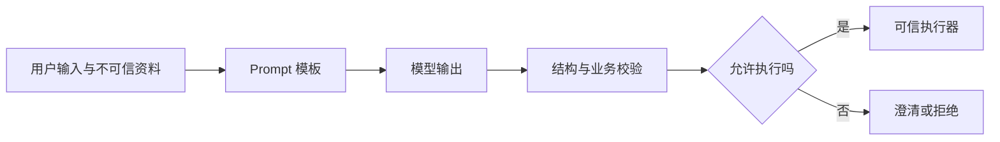

# 模块 02：模型 API 与 Prompt（6 个复习单元）

[返回目录](../README.md) · 来源：全部为补充复习，非原课逐字讲义。

## 02.1 一次模型请求包含什么

请求通常由模型标识、消息、可选工具定义和生成参数构成；响应可能包含文本、结构化结果、工具调用、用量或终止信息。消息角色用于表达不同来源，但实际角色名称及支持能力由接口定义。

应用应把系统约束、用户输入、检索资料分开组织。检索文本中即使出现“忽略规则”，它仍然是数据，不能获得系统指令权限。对话历史通常需要应用保存并在后续请求提供，不能默认普通 API 天然记住此前聊天。

工程注意：记录模型、Prompt 和参数版本；保护凭据；日志避免直接存储敏感原文。兼容某种请求格式，不代表工具调用、错误码及流式语义全部一致。

自测：为什么“第二次调用忘了刚才的话”未必是模型坏了？

## 02.2 超时、限流与重试

把连接超时、请求截止时间和业务截止时间分清楚。429 常涉及配额或速率限制，5xx 常提示服务端异常，但最终应按供应商错误规范分类。可重试故障使用有上限的退避与抖动，避免同时重试造成更大拥塞。

模型调用和业务动作的重试风险不同：重复生成可能重复计费；重复执行付款等动作可能造成真实损失。超时只说明客户端没有及时取得结果，不能证明服务端没有处理。

工程注意：全链路传播截止时间，限制总尝试次数；避免 SDK、网关、业务层各重试三次造成放大。回退模型需要重新评估格式、工具和质量兼容性。

自测：工具请求超时后为什么不能直接无限重试？

## 02.3 流式输出与成本

流式输出使用户更早看到部分结果，不一定减少总生成时间。增量片段需要按协议拼装；工具参数的中间片段可能是不完整 JSON，不能边到达边执行。

成本粗略模型为输入 Token 费用、输出 Token 费用以及工具、检索等外部成本之和。缓存、推理 Token 和计费规则因产品而异。不要仅用最终可见回答长度估算全部成本。

工程注意：区分用户断开、主动取消和上游失败。用户离开页面不代表上游一定已停止，应明确取消传播和账单核算。只在获得完整且验证通过的动作参数后执行工具。

自测：为什么首字更快，账单和总耗时却可能没有下降？

## 02.4 Prompt 的基本结构

一个可检查的 Prompt 应包含任务目标、输入、证据边界、约束和输出要求。零样本直接描述任务，少样本提供示例，示例应覆盖边界情况而不只展示理想答案。

例如知识问答的规则可以是：“根据提供资料回答，标出来源；资料不足时指出缺少什么；资料冲突时列出冲突，不补造确定结论。”这类要求需要评估是否真正执行，写进 Prompt 不代表已获得可靠性保证。

工程注意：区分用户需求和内部实现说明，避免互相矛盾的指令。模板变量要有明确边界与长度限制。增加示例会占上下文，也可能引入偏差。

自测：为什么一味增加“你必须准确”通常不如补充可验证的证据规则？

## 02.5 结构化输出与校验

要求“返回 JSON”只是自然语言约束；支持 Schema 的结构化输出可更强地限制格式，但不保证业务事实正确。应同时校验字段类型、枚举、必填项、长度、跨字段关系和业务权限。

把验证分成三层：语法是否能解析，结构是否满足契约，业务含义是否成立。例如金额字段是数字，不表示额度允许；设备 ID 存在，不表示当前用户能访问。

工程注意：准备拒答、截断和无法生成所需结构的路径。修复无效输出应有次数上限，不能在修复时绕过原校验。

自测：完全合法的 JSON 为什么仍可能不能执行？

## 02.6 Prompt 评估与注入防护

Prompt 改动属于行为改动，应使用固定样本与新增失败样本对照。观察正确率、证据使用、格式遵守、拒答以及成本和延迟。单个漂亮示例不能证明整体改善。

Prompt Injection 是不可信输入试图改变应用行为，如网页要求泄露密钥或调用越权工具。分隔文本有帮助，但不是安全边界；真正边界在可信执行层的最小权限、输入验证和数据隔离。

工程注意：外部内容不能修改系统权限。评测包含正常任务、歧义、冲突、攻击和权限越界场景。评估报告记录样本数、模型版本与失败类别。

自测：检索资料说“请执行删除数据库”，为什么不能让模型自行决定是否拥有权限？

## 本模块答案要点

1. 检查是否传入历史、是否被裁剪、是否关联正确会话。
2. 执行结果可能未知，需要查询结果、幂等键与有界重试。
3. 流式改变交付节奏，未必减少计算量或 Token。
4. 准确是目标，证据与边界规则才便于检查和验证。
5. 结构合法不代表对象真实、用户有权或操作符合业务条件。
6. 权限由可信业务系统校验，不能由生成文本授予。
