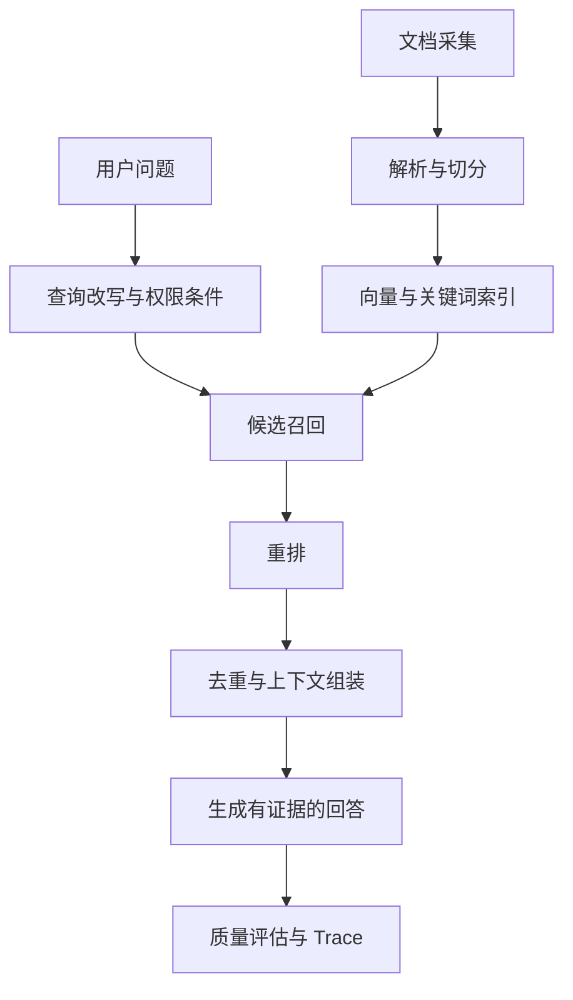

# 模块 03：RAG（8 个复习单元）

[返回目录](../README.md) · 来源：补充复习；故障诊断另结合原对话整理。

## 03.1 RAG 的作用与边界

Retrieval-Augmented Generation 在生成前查询外部知识，将证据放入模型上下文。它把可更新事实放在外部系统中，便于更新和引用，但不自动保证真实性。错误资料、错误召回、错误组装和错误推理都能导致失败。

RAG 适合文档问答；精确余额、库存等结构化事实往往应调用权威业务接口。RAG 与微调可以组合，前者解决外部证据获取，后者更偏行为模式学习。

工程注意：先明确回答必须基于什么来源、哪些问题不能回答，以及资料更新时效要求。

自测：接了知识库之后为什么仍会幻觉？

## 03.2 解析、清洗与元数据

离线链路通常包括采集、解析、清洗、切分、向量化和入库。解析阶段丢失表头、否定词或脚注，后面再强的模型也无法恢复真实证据。扫描 PDF 可能需要 OCR，表格需要保留行列关系。

元数据应包含文档 ID、版本、来源、更新时间、标题、权限及片段定位。引用应能回到具体位置；只给一个相似标题不足以核验。

工程注意：删除与权限变更也要同步到索引。保留可追踪的解析版本和失败队列，避免“上传成功”却没有有效文本。

自测：表格问答错误时为什么应先看解析产物？

## 03.3 Chunk 与上下文完整性

Chunk 太小会丢条件，太大会混入噪声并占用预算。按标题、段落和语义结构切分，通常比固定字数更能保留关联，但需要数据验证。Overlap 可减少边界丢失，也会造成重复召回。

父子块策略可以用小块检索，再取较大父块供回答。必须同时维护父子映射和权限；不能因为命中一个小块就泄露更大范围的受限内容。

工程注意：没有通用最佳块大小；比较不同切分在真实问题上的证据覆盖与成本。定义去重规则，避免重复片段挤占上下文。

自测：为什么不能说 Chunk 越小检索越准？

## 03.4 向量索引与召回

Dense Retrieval 用向量表示查询和文档，再按距离寻找候选。ANN（近似最近邻）通过索引换取速度，可能牺牲精确最近邻召回；这与“业务上是否找到了正确文档”不是同一个指标。

TopK 只是候选数量。调大可能增加正确证据，也增加噪声、重排成本和延迟。过滤条件、语料覆盖、向量模型与索引配置都影响结果。

工程注意：查询与文档模型兼容；重建索引时设计版本切换、回退和完整性核验。权限过滤要在可信检索链路落实，不能只靠最终回答隐藏。

自测：增加 TopK 为什么有时使答案更差？

## 03.5 关键词、混合检索与 Query Rewrite

关键词检索适合精确编号和术语；向量检索擅长表达差异较大的语义匹配。混合检索结合两者，可用名次融合等方法；不同检索分数不能未经校准直接相加。

Query Rewrite 把口语或省略问题改写为更适合检索的查询。多轮问题需要补全指代，但不能悄悄改掉用户的时间、产品型号或否定条件。

工程注意：同时记录原问题与改写结果；以业务查询集比较混合策略，不能预设混合一定提升所有类别。

自测：型号“AB-123”查不到，为什么值得试关键词检索？

## 03.6 Reranker 与 Context Builder

Retriever 先低成本找候选，Reranker 再结合问题对候选精细排序；它无法找回根本不在候选集中的证据。Context Builder 负责去重、保留出处、补充邻接内容和按 Token 预算组装。

正确证据进了 Retriever 却没进最终 Prompt，可能在重排、过滤、去重或截断任一阶段丢失。必须比较阶段输入输出，不能直接判定 Reranker 出错。

工程注意：记录文档 ID、排名、保留理由和裁剪原因。保留证据的适用条件，避免只抽出有利结论。

自测：Top5 有正确文档，Prompt 没有，下一步看什么？

## 03.7 证据、引用与冲突

回答应能对应到证据，并区分直接陈述与基于证据的推断。引用存在不代表引用支持该结论，需要逐项检查支持关系。证据不全时可以澄清或说明不足。

两份文档冲突时，检查版本、生效时间、适用对象与来源权威。若无法消解，不应把两段话拼出一个确定结论。文本里的“通常”不能被改写为“一定”。

工程注意：证据优先级应来自可信规则和元数据；文档不能通过自称“最高优先级”取得权限。

自测：相关文档都召回了，为什么仍不能认定答案正确？

## 03.8 评估与排查

检索层评估证据是否进入候选，排序层评估位置，生成层评估正确性与证据忠实性。Recall@K 关注相关项覆盖，NDCG 关注有等级相关性的排序；具体标注口径必须写清楚。

Golden Dataset 应包含问题、可接受答案、证据、时间与权限条件，以及无答案和冲突样本。固定历史集用于回归，新增失败样本扩充覆盖，留出独立集合防止只优化熟悉题。

工程注意：模型裁判只是辅助，校准其与人工判断的一致性；同时看成本、P95 延迟和拒答是否合理。

自测：Faithfulness 很高但 Answer Correctness 很低，可能发生了什么？

## 本模块答案要点

1. 检索只提供材料，不保证材料对、用得对、推理对。
2. 检查表头、单位、行列和脚注是否保留。
3. 小块可能把限制条件与结论分开。
4. 噪声和重复内容占预算，可能误导模型。
5. 稀有精确标识的语义向量匹配可能不稳定。
6. 依次检查重排输出、过滤与预算裁剪记录。
7. 相关不等于支持，还要看适用条件与冲突。
8. 模型忠实复述了错误、过时或答非所问的材料。
