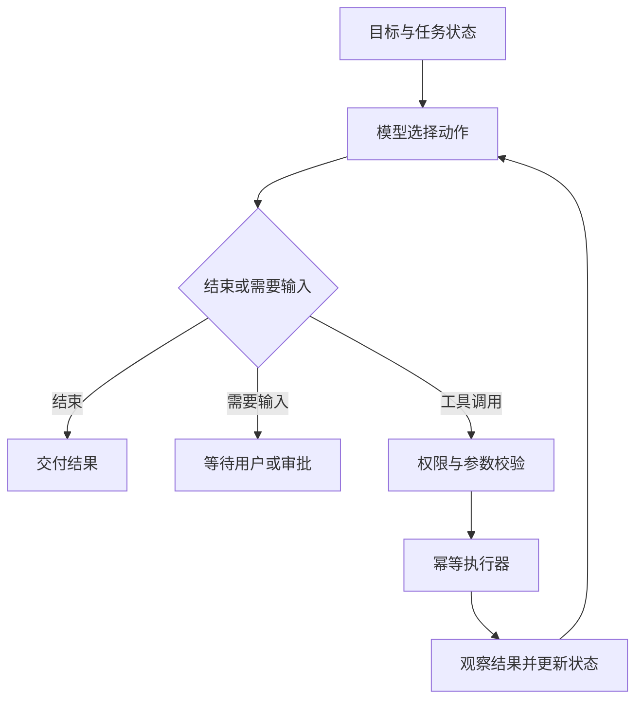

# 模块 04：Agent 与工具调用（8 个复习单元）

[返回目录](../README.md) · 来源：补充复习，原课正文未取回。

## 04.1 Agent 和 Workflow

Agent 根据目标、观察和状态选择下一步行动；Workflow 由程序预先规定主要执行路径。二者可组合，例如固定审批流程中用模型分析文本。使用模型并不自动构成 Agent，Agent 也不必是无限自主循环。

确定规则应尽量由可信业务代码执行；需要处理开放语义和动态工具选择时再引入模型决策。复杂度增加的依据应是任务需求，而非工具数量。

自测：固定三个模型节点串联，是否一定需要称为自主 Agent？

## 04.2 Tool Calling 的执行边界

模型根据工具描述生成工具名和参数，应用校验后调用真实系统，再把工具结果返回模型。模型提出动作，执行器产生副作用。工具定义至少应清楚说明用途、参数和错误含义。

工具返回值也可能包含不可信文本，不能因此改变系统权限。查工单和取消工单应该有明确的业务语义，避免一个万能工具暴露无限能力。

工程注意：服务端校验身份、租户、对象归属、参数与当前状态；不能使用模型自报的用户 ID 当可信身份。

自测：模型输出了有效工具参数，为什么还需要业务校验？

## 04.3 ReAct 与行动循环

ReAct 的核心是交替规划行动与观察结果：例如先查设备，再根据返回的故障码查维修手册，最后形成结论。实现不必向用户暴露内部推理文本，日志应保存可审计的动作、输入、结果和决策摘要。

必须定义停止条件：任务完成、无可用动作、预算耗尽、连续无进展或需要用户补充。重复相同查询不是“在深入思考”，可能是失控循环。

工程注意：最大步数、总时限、Token 与费用预算一起约束；失败时返回已完成内容和未完成原因。

自测：为什么只设置单次模型超时不能控制 Agent 总耗时？

## 04.4 State、短期记忆与长期记忆

State 包含当前任务的目标、进度、已取得证据和待执行动作。会话消息只是其一部分。短期记忆服务当前上下文，长期记忆跨任务保存偏好或事实，需要来源、时间、纠错与删除机制。

摘要会压缩信息，也可能丢掉否定条件和审批约束。不能把模型摘要直接升级为业务事实，重要状态应有结构化字段及权威记录。

工程注意：按用户和租户隔离记忆；区分“用户说过”和“已验证事实”。长期保存应符合用户授权和数据管理要求。

自测：对话摘要写着“已批准”能否代替审批记录？

## 04.5 规划、分解与执行反馈

计划把大目标拆成可检查步骤，但计划不是事实，环境变化后需要调整。适合使用“准备计划 → 执行一步 → 检查观察 → 修订计划”的闭环，而不是一次生成所有调用后盲目执行。

任务拆分应写明依赖、输入、输出与完成条件。例如查询库存可以并行，但库存不足时的采购动作依赖查询结果。

工程注意：限制递归深度、子任务数量和并发；让模型规划不意味着允许它修改权限策略或审批规则。

自测：哪类步骤可并行，哪类必须等待？

## 04.6 幂等、重试与未知结果

幂等表示同一业务操作重复请求不会造成重复效果，通常依赖稳定 operationId、唯一约束和结果记录。它不同于“每次都返回一样的文本”。

最危险的情况是下游已写入，调用方却超时。此时先查询该 operationId 的结果；不能换一个新 ID 再提交。读操作常较容易重试，写操作需要明确幂等契约。

工程注意：幂等键应绑定规范化业务参数；同键不同参数应拒绝或显式处理。Checkpoint 并不能代替下游幂等。

自测：建单成功但保存图状态失败，恢复时如何避免重复建单？

## 04.7 人工确认与补偿

Human-in-the-loop 在风险控制点请求人类决策。确认应绑定具体操作、参数版本、审批人和有效期；用户批准旧报价不等于批准修改后的金额。

补偿是执行新的业务动作抵消影响，例如取消订单或退款，不等于回滚数据库事务。外部邮件可能无法撤回，补偿也可能失败，因此执行前必须明确边界。

工程注意：恢复时再核验业务状态；审批超时、拒绝、取消和参数变更都应有终态路径。

自测：为什么审批通过三小时后仍需要重新检查库存与价格？

## 04.8 工具安全与可观测性

通过最小权限、工具白名单、参数验证和外部访问限制控制执行范围。针对文件路径、URL、数据库条件等输入，需由对应执行环境检查；Prompt 提醒无法替代这些控制。

Trace 应关联请求、任务、模型调用、工具调用和业务 operationId；记录耗时、错误类型、版本与校验结果。敏感参数需要脱敏，不能为了排查而公开保存全部数据。

自测：一次失败应能回答哪些问题？答：谁请求、做了什么、哪里失败、是否产生副作用、能否重试。

## 本模块答案要点

1. 不一定，主要路径可以是固定 Workflow。
2. 结构合法不代表被授权，模型也可能引用错误对象。
3. 多次调用和等待会累积，需要总预算。
4. 不能，必须查可信审批服务并绑定操作。
5. 没有数据依赖且资源允许的步骤可并行。
6. 用同一 operationId 查询或重试，由下游保证去重。
7. 外部业务条件可能改变，旧批准也可能过期。
8. 要区分模型失败、工具失败和结果未知，并保护日志中的敏感信息。
