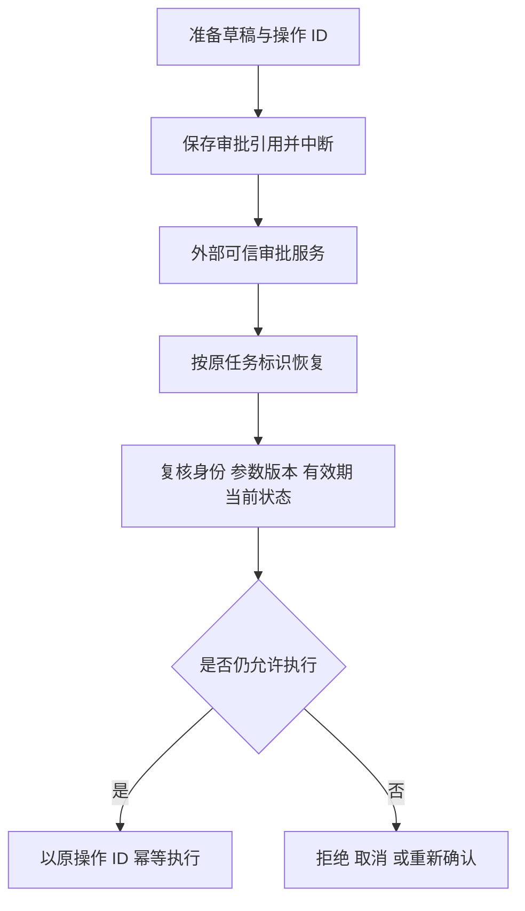
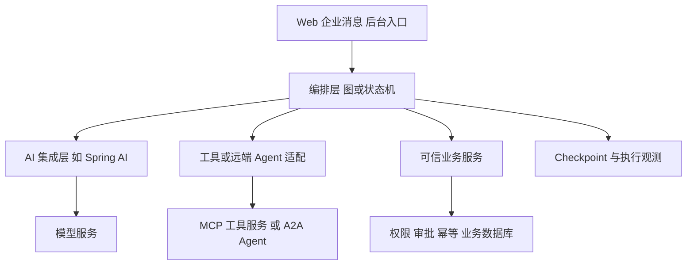

# 模块 05：Agent 框架与编排原理（8 个复习单元）

[返回目录](../README.md)

模块 05 的 8 讲现已全部从可读取的原课正文整理为独立笔记。本页下半部保留初版速查，深入学习请进入下表。真实标题按正文核对；第一讲原题含“实战”，后续按用户要求转为原理扫盲，不要求编码。

| 原课 | 已核对标题 | 独立正文 |
|---|---|---|
| 01 | Spring AI 与 Agent 框架实战入门 | [第二批](module-05/01-spring-ai-introduction.md) |
| 02 | Spring AI 的架构原理与工具调用机制 | [第二批](module-05/02-tool-calling-internals.md) |
| 03 | Agent State、Memory 与 Checkpoint 的底层原理 | [第二批](module-05/03-state-memory-checkpoint.md) |
| 04 | LangGraph 与图编排的底层原理 | [第二批](module-05/04-langgraph.md) |
| 05 | MCP 协议的底层机制与工具生态 | [第二批](module-05/05-mcp.md) |
| 06 | Multi-Agent 多智能体协作原理 | [第一批](module-05/06-multi-agent.md) |
| 07 | Human-in-the-loop 在 Agent 框架中的实现原理 | [第一批](module-05/07-human-in-the-loop.md) |
| 08 | Agent 技术架构全景与框架选型 | [第一批](module-05/08-architecture-selection.md) |

以下速查来自初版概念重组，不能用其节名替代真实课名。特别是第五节中的 A2A 也在真实第六讲详细展开。

## 05.1 Spring AI 框架定位与核心组件

Spring AI 为 Spring 应用提供模型能力集成，ChatClient 提供构造 Prompt 与获取响应的调用方式，支持同步与流式交互。应区分业务服务、模型客户端与外部模型服务的职责。[官方文档](https://docs.spring.io/spring-ai/reference/api/chatclient.html)

选用集成框架有助于减少适配重复，但不能假设不同模型的工具能力、参数和错误语义完全相同。本文不固定 Spring AI 与 Spring Boot 兼容版本；落地需查版本矩阵。

自测：接入 ChatClient 后，业务权限和事务是否由框架自动解决？

## 05.2 ChatClient、Advisor、Tool Calling 循环

模型适配层负责传递工具定义、接收工具请求；工具分发层将其映射到可调用能力；业务服务校验并执行。即使框架自动完成多轮工具循环，也需要看清调用次数、超时、异常和结果回传。

工具执行应有稳定的业务操作标识。不可因回调函数写起来方便，就把所有写库逻辑直接放在缺少权限和幂等保护的工具入口。

工程注意：明确并行工具调用是否支持、冲突写入如何串行化、错误如何让模型感知。

自测：同一轮模型提出两个会修改同一订单的调用，应检查什么？

## 05.3 State、Memory、Checkpoint、Event Log

State 是任务数据，Checkpoint 是执行到某个边界时保存的状态及运行进度。消息历史主要描述对话，Checkpoint 主要支持恢复，两者用途不同。

保存状态不代表所有外部副作用也同步提交。业务库写入与图状态持久化通常不在同一个事务中，必须处理两个系统之间的失败窗口。状态中的“已成功”不能凭空成为下游真实结果。

工程注意：为任务、业务操作、会话分别建标识，避免混淆；持久化状态要支持 Schema 演进、访问隔离与保留周期。

自测：有 Checkpoint 为什么仍可能重复发送消息？

## 05.4 LangGraph、Node、Edge、Reducer、Super-step

Node 执行工作，Edge 表达流转，State 传递数据。条件边把业务结果映射到下一节点；并行分支汇合时，需要定义如何合并多个状态更新，不能默认覆盖顺序正确。

图结构使路径、失败和恢复边界更明确，但不会自动降低模型不确定性。规则明确的分支应依据可信字段决定，而非依赖模型自由生成节点名。

工程注意：区分节点局部失败与任务整体失败，设置重试边界、取消与总预算。长任务升级时考虑旧图与新图的兼容。

自测：两个分支同时写同一个状态字段，可能发生什么？

## 05.5 MCP 协议、工具发现、传输与权限

MCP 标准化 AI 应用连接外部工具与数据的方式，A2A 关注 Agent 间互操作；它们不是模型，也不是业务数据库事务方案。可以在一个系统中分别承担不同连接职责。[MCP](https://modelcontextprotocol.io/docs/getting-started/intro) · [A2A](https://a2a-protocol.org/latest/)

采用协议不能省去身份认证、授权和审计。不要认为可发现一个工具就可以调用它，也不要认为远端 Agent 发来成功消息就等于己方业务已完成核验。

工程注意：协议与 SDK 版本会演进；本文只讲职责边界，不承诺跨任意版本兼容。接入前验证能力、错误、取消和超时契约。

自测：为什么 MCP 和 A2A 通常不是简单的二选一？

## 05.6 Multi-Agent 多智能体协作原理

[完整整理正文](module-05/06-multi-agent.md)。本节仅为速查。

Supervisor 统一分派并汇总；Router 选择处理者；Handoff 转交当前交互或控制责任；Peer-to-Peer 允许相对分散协作。具体框架对这些名称的实现可能不同，需要看实际控制流。

多 Agent 适合专业边界清晰、权限不同或确有并行收益的任务，也带来重复上下文、通信延迟、协调错误与预算放大。单 Agent 加工具能够解决时，不应为了架构外观拆多个角色。

工程注意：定义任务契约、唯一任务 ID、完成条件、超时和责任归属；防止子任务相互递归委派。

自测：多 Agent 为什么可能比一个 Agent 更慢、更不稳定？

## 05.7 Human-in-the-loop：暂停与恢复

[完整整理正文](module-05/07-human-in-the-loop.md)。本节仅为速查。

**原对话第七讲整理。** 持久化等待保存状态后释放执行资源；它与一直占用线程等待不同。LangGraph 的动态中断通常配合 checkpointer 和相同 `thread_id`，外部通过 `Command(resume=...)` 提供恢复值。

关键是：恢复会重新进入被中断节点，`interrupt()` 之前的代码可能再执行，不能理解成恢复内存调用栈的下一行。把准备、等待、复核、执行分成明确步骤能缩小重放范围，但外部写入仍需幂等。[中断恢复语义](https://docs.langchain.com/oss/python/langgraph/interrupts)

审批事实由审批服务维护，Graph State 只关联记录。恢复值中的 `APPROVED` 不是认证凭据。重复回调、审批过期、任务取消与工作流版本变化都要有明确处理。

子 Agent 若作为同步子图调用，中断可能沿父调用路径传播；若是独立服务任务，可以维护独立等待状态。其他无依赖分支能否继续由实际图和调度机制决定，不能笼统说“一个子 Agent 等审批就暂停整个系统”。

自测：审批节点前调用建单接口，三小时后恢复，最危险的结果是什么？

## 05.8 架构全景与选型

[完整整理正文](module-05/08-architecture-selection.md)。本节仅为速查。

**原对话第八讲整理。** 技术应放到职责层次比较：集成层负责模型和工具适配，编排层负责控制流及恢复，协议层连接外部能力，业务层决定权限与操作是否成立。

普通问答可能只需模型调用；文档问答加检索；固定业务路径可用常规流程；需要动态行动时引入 Agent；需要长期暂停恢复时评估持久化编排；跨 Agent 互操作时再评估协议。

选型应回答：谁决定下一步、状态存哪里、失败后从哪里重试、哪些动作需确认、由谁保证不重复写入。既有工作流引擎和 AI 框架可以分工，不需要为了使用 AI 重建已有业务审批。

自测：Spring AI、LangGraph、MCP 为什么不能直接按“谁功能最多”选一个替代其余全部？

## 本模块答案要点

1. 不会，权限与事务仍由可信业务层负责。
2. 检查依赖、冲突、版本与幂等，必要时串行化。
3. 下游成功与状态保存之间仍有失败窗口。
4. 更新覆盖或合并冲突，需要明确 reducer 或其他合并规则。
5. 分别处理应用到外部能力、Agent 到 Agent 的连接问题。
6. 额外协调与上下文传输增加成本和失败机会。
7. 节点重放造成重复建单；使用独立步骤和稳定 operationId。
8. 处在不同职责层，不能用单一功能数量作跨层比较。
