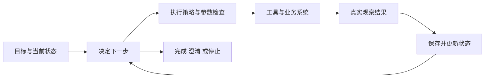
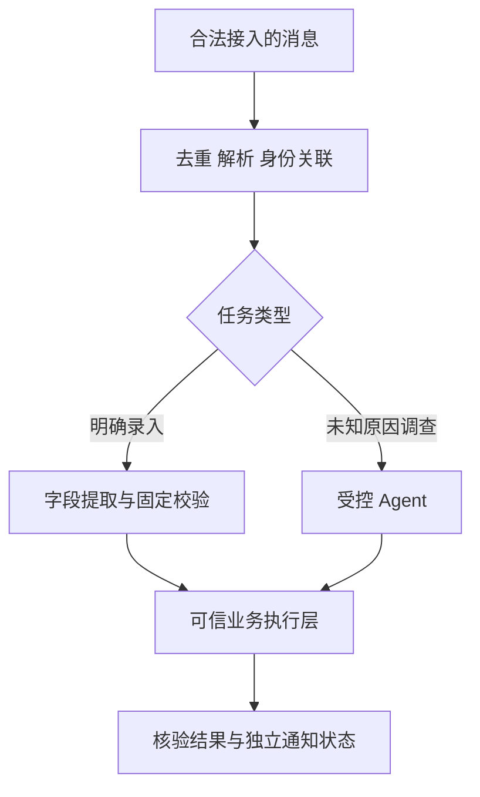

# 模块 04 · 第一讲：Agent 的本质、决策循环与 Workflow 的区别

[总目录](../../README.md) · [模块目录](../04-agent-tools.md) · [下一讲：ReAct](02-react.md)

**来源**：原聊天第一讲正文及模块路线表，2026-11-06 核对。原文从“模块 04 的学习路线”开始，本页标题依据原课路线中的本讲名称。本文整理重写，原课代码改为机制说明；新增解释与练习单独标注，不要求编码。

## 1. 从 RAG 到 Agent，增加了什么

RAG 主要解决回答需要哪些外部证据。用户要求调查订单失败时，系统可能要先查订单，再按错误查询支付、日志和知识库，甚至请求补充信息。开始时无法确定全部路径，后续动作依赖前一步观察。

原课采用工程上的定义：Agent 以模型为部分决策核心，根据目标与环境反馈，在受限制的行动空间中动态选择后续动作。它不是一个统一、严格的行业定义；讨论时应先约定所指能力，而不是争论某个产品是否够资格叫 Agent。

本讲要能区分工具接口、固定流程与反馈驱动决策，并说明它们如何组合。

## 2. 四个要素组成闭环

| 要素 | 问题 | 订单调查例子 |
|---|---|---|
| Goal | 用户要达成什么 | 查明支付失败原因 |
| Policy | 依据什么选下一步 | 根据状态、观察和执行约束决定 |
| Action | 通过什么与环境交互 | 查询订单、支付状态或日志 |
| Observation | 得到了什么真实反馈 | 支付超时、交易未扣款等结果 |

原课用三个关系说明控制过程：`动作 = 策略(当前状态, 已知观察)`，`新观察 = 环境(动作)`，`新状态 = 更新(旧状态, 动作, 新观察)`。这是帮助理解的抽象，不要求系统实际实现三个同名函数。

没有 Observation，系统只能把预期结果当事实。提出 `create_ticket` 不能证明工单存在，必须读取真实执行结果或核验业务状态。

## 3. Function Calling、Workflow、Agent

| 比较对象 | 核心作用 | 模型能否参与 | 是否自然具备完整自主执行 |
|---|---|---|---|
| Function Calling | 用结构化方式提出工具名和参数 | 是 | 否，它是交互机制 |
| Workflow | 依预定义路径执行步骤 | 可用于分类、提取或分析节点 | 路径主要由程序确定 |
| Agent | 根据反馈动态决定部分行动路径 | 模型承担动态决策 | 自主范围仍由系统限制 |

“LLM 分类 → 校验字段 → 入库 → 通知”即使调用模型，仍可以是固定 Workflow。相反，“先看哪个系统报错，再决定查哪个工具”体现运行时路径选择。

两者可嵌套：Workflow 中放调查 Agent，Agent 调用固定业务流程。Function Calling 又可以作为 Agent 的行动接口。它们不是互斥选项。

参考：[Anthropic 对工作流与 Agent 的架构区分](https://www.anthropic.com/research/building-effective-agents)。该文是原理参考，不作为当前框架 API 指南。

## 4. 订单支付调查的完整轨迹

原课虚构订单 10086：先查订单得 paymentId，再查支付记录得 PAYMENT_TIMEOUT，检索错误说明后得知还需核实真实交易，最后查询支付平台确认未扣款。

| 步骤 | 得到的信息 | 对下一步的影响 |
|---|---|---|
| 订单查询 | 支付记录关联 | 确定应查哪一笔支付 |
| 支付状态 | 超时错误 | 尚不能判定是否扣款 |
| 错误说明 | 建议核验真实交易 | 新增交易状态查询 |
| 交易查询 | 教学环境确认未扣款 | 形成有依据的解释 |

关键不是用了四次 API，而是新信息改变了后续查询。**补充解释：**超时、失败、未扣款是不同事实。即使最后可以建议重新支付，也不能把案例结论推广到所有超时交易。

## 5. 自主选择行动，不等于自主决定权限

原课将只读、低风险写入、高影响操作作教学分级。风险规则应由业务定义；查询也可能泄露敏感数据，不能认为“只读就无需授权”。

可信执行层至少控制：当前允许的工具、用户与租户、目标资源、参数、审批、调用轮数、总时间、费用和审计。模型可以在范围内提出行动，不应生成自己的管理员身份或放宽预算。

**补充解释：**控制应覆盖所有执行路径。某工具绕过策略入口直接访问数据库，即使其余调用都经过检查，也会形成旁路。把安全要求写进 Prompt 只是行为指导，不是强制边界。

## 6. 企业消息案例应分两种路径

客户给出明确设备与报修字段时，可用模型提取，再由固定规则校验、生成待处理记录。用户只说“又报警了，像上次一样”时，需要查台账、报警和历史记录，适合受控调查 Agent。

这是逻辑设计，不表示企业消息平台已提供全部接入、审批和回群通道。读取能力与发送能力要分别确认；课程提出的架构也不能写成用户已经完成的功能。

## 7. 最小 Loop 背后的执行职责

原课 Java 代码可归纳为：读取任务状态，检查预算，让模型输出工具请求或结束意图，执行合法工具，保存观察，再进入下一轮。

生产中还要处理多个调用、参数无效、异常、审批、并发领取、取消和恢复。最小循环只展示反馈机制，不是可上线运行时。

原课建议区分 COMPLETED、BLOCKED、FAILED 等终态：完成必须有可信依据；阻塞说明缺信息、需授权或预算不足；失败说明执行错误。具体枚举可按业务细化，不能把模型不再调用工具一律记为完成。

## 8. 哪些场景不必增加 Agent

固定表单流程已经明确时，动态循环可能只增加成本。高影响业务可以使用模型理解意图，但最终权限与执行应交给确定性流程。一次检索已足够回答的问题，也不必再加 Planner 和多轮反思。

判断依据是动态性带来的实际收益。**新增纸上练习：**给日报汇总、支付异常调查和退款申请各画一条最简路径，标出哪里需要模型、哪里必须由业务规则决定；不要为了统一技术栈而强行使用同一种架构。

## 9. 原课 4 道自测与解析

1. LLM 分类工单后固定入库，更接近哪种架构？
2. Agent 与 Workflow 的核心区别是什么？
3. 建单工具超时，能直接回复创建成功吗？
4. 复杂调查后需要修改生产配置，如何处理？

展开答案

1. Workflow，使用模型不改变主要路径预定义的事实。
2. 部分路径是否由模型根据反馈动态选择，而非编程语言或工具数量。
3. 不能。核验业务结果，结果未知时走幂等恢复。
4. 调查与修改分开，按授权和必要审批由可信业务执行器实施。

面试表达：先解释动态决策的必要性，再说反馈闭环、行动边界和业务完成标准。不要只说“LLM 加 Tools 就是生产 Agent”。
