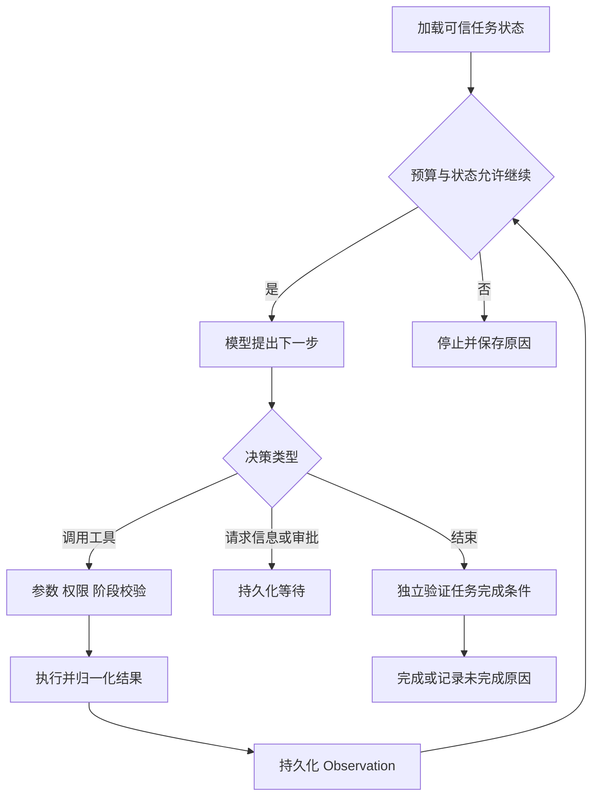

# 模块 04 · 第二讲：ReAct——Agent 如何在行动与观察中完成任务

[总目录](../../README.md) · [模块目录](../04-agent-tools.md) · [上一讲](01-agent-workflow.md) · [下一讲：Planning](03-planning.md)

**来源**：原聊天第二讲正文、设备调查轨迹、循环守卫演示与 4 道知识检验；2026-11-06 核对。本文为整理重写，代码改为可纸上推演的执行机制，新增说明另行标记。

## 1. ReAct 的核心是行动后的反馈

ReAct 将推理与外部行动交替结合，使下一步可以依据实际观察调整。[原始论文](https://arxiv.org/abs/2210.03629)于 2022 年提交，后有 2023 年版本。本资料关注工程上的决策、行动、观察闭环，不要求复现论文实验。

Function Calling 描述模型如何提出一次工具请求；ReAct 描述多轮请求与反馈如何服务一个目标。现代系统可以用结构化工具调用实现这个循环，不必照搬 `Thought / Action / Observation` 纯文本格式。

生产审计应保存动作、参数、结果和可核验的决策摘要，不需要索取或展示模型私有的内部推理过程。

## 2. 设备调查：每一步缩小未知范围

原课虚构请求：“12 号设备又报警，和上周好像一样。”已知目标不等于已知具体设备、报警码或根因。

| 行动 | 观察 | 可支持的下一步 |
|---|---|---|
| 查找授权范围内设备 | DEV-0012，温控终端 | 查询该实体报警 |
| 查询近期报警 | 通信超时 | 比较相关维修历史 |
| 查询历史维修 | 曾检查接线后恢复 | 检索同类故障建议 |
| 查询知识库 | 应检查链路、线缆、接口 | 形成解释与未确定项 |

结论可说故障类型与上次一致，建议进一步排查；不能仅凭这些记录确认本次根因。调查过程没有设备修改，回答也不能声称已经修复。

**补充解释：**需要保持对象、时间和来源关联。若报警属于设备 A、维修属于设备 B，即使文本看起来支持“反复故障”，整条结论仍然无效。

## 3. 执行器控制循环，而不是让模型自行约束

模型生成 Finish 只是结束建议。任务是建单时，要核验真实工单；任务是分析时，要核验是否回答了问题以及结论是否有证据。工具成功只代表一个步骤完成。

原课状态可包括 CREATED、RUNNING、WAITING_INPUT、WAITING_APPROVAL、COMPLETED、FAILED、CANCELLED、EXPIRED。名称不是统一协议，重点是能区分等待、失败、取消与预算停止，而不把所有非成功都混为“回答失败”。

## 4. 哪些错误交执行器，哪些会改变决策

| 错误类型 | 通常优先由谁处理 | 处理方向 |
|---|---|---|
| 429、503、短暂网络问题 | 确定性执行层 | 有界退避、限流、熔断 |
| 参数格式不合法 | 校验层与受限纠错 | 返回具体错误，限制修正次数 |
| 设备不存在或歧义 | 任务决策与澄清 | 补充客户范围或请求信息 |
| 无权访问 | 可信授权层 | 阻断，不允许换参数绕过 |
| 写入结果未知 | 业务执行与对账层 | 查稳定操作标识，不凭模型猜测 |

工具不宜只返回“失败”。结构化 Observation 应区分状态、错误码、是否可重试、数据及关联标识。`retryable` 应来自可信执行策略，而非模型看到错误后自行改写。

**补充解释：**403 不应该被当作可通过反复换设备 ID 解决的普通参数问题。错误分类也限定了模型的行动空间，影响系统是否会在失败后越界。

## 5. 四种预算与无进展检测

原课要求由程序强制限制决策轮次、工具调用次数、总时限及单工具超时、Token 和费用。Prompt 中写“尽量少调用”不能代替这些限制。

连续三次相同工具、参数和 NOT_FOUND 的演示，说明应该主动发现无进展。但“相同文本”只是简化信号：轮询异步任务可能有业务必要，重复查询也可能得到新版本数据。

**新增推演：**两次查询都返回 OFFLINE，但记录时间和状态版本不同，是否值得继续，要看任务是否在等待恢复以及是否有允许的轮询策略。相反，轮换两个同义搜索工具却没有新增证据，同样可能是无进展。

停止时保存已确认信息、剩余缺口和停止原因，使下一次澄清或人工介入有依据。不能达到步数后自动编造完整结论。

## 6. ReAct 与 Planning 的关系

ReAct 倾向于每次观察后决定下一步，适合未知故障。Plan-and-Execute 先列可执行子目标及依赖，适合多阶段、多产物任务。前者可能循环和遗漏，后者可能初始计划失真。

二者可组合：高层计划明确要完成什么，某个调查步骤内部用 ReAct 寻证；新事实改变前提时再局部重规划。不是每次执行前都需要生成完整计划。

## 7. 恢复不应绑在一个 HTTP 请求上

长调查或审批等待适合先持久化任务，再交给 Worker。客户端连接断开不应使业务事实丢失，也不能默认等于撤销已发出的动作。

执行轨迹至少关联 taskId、步骤、模型决策、工具请求和结果。恢复时重新读取可信状态，避免只靠模型对聊天的回忆判断做到哪里。

建单成功但响应丢失是结果未知：先用持久化 operationId 查下游，必要时以同键幂等重试。内存里记住一个 ID 并不足够，下游必须支持去重或可靠的业务约束。

## 8. 好的轨迹不是工具越少越好

原课比较同样答对却调用 18 次和 4 次工具的两条轨迹。还应比较必要证据、重复调用、越权尝试、恢复成功率、端到端 P95 和成功任务成本。

为了压缩调用数省掉关键核验，会降低可靠性。评价“效率”应以同等成功条件为前提，不能把缺证据的短轨迹奖励为最佳方案。

**新增例子：**A 用三次工具就声称支付未扣款，B 用四次工具核验了真实交易。若业务要求确认扣款状态，B 的额外步骤是必要工作，不是冗余。

## 9. 原课 4 道自测与解析

1. ReAct 的核心执行机制是什么？
2. 建单超时但可能成功，如何处理？
3. 相同参数反复 NOT_FOUND，执行器该做什么？
4. 调查后需要修改生产配置，下一步是什么？

展开答案

1. 依据每轮环境反馈重新选择下一步，而非预先写完固定脚本。
2. 用原操作标识核验结果，按幂等契约受控恢复。
3. 检测无进展并安全停止、换有依据的策略或请求信息，不无限循环。
4. 进入授权和必要审批，再由可信执行器操作。

面试表达可以按“目标 → 观察驱动 → 错误分类 → 循环守卫 → 完成核验 → 持久化恢复”展开。能讲出一个失败分支，比只画成功循环更能说明理解深度。
