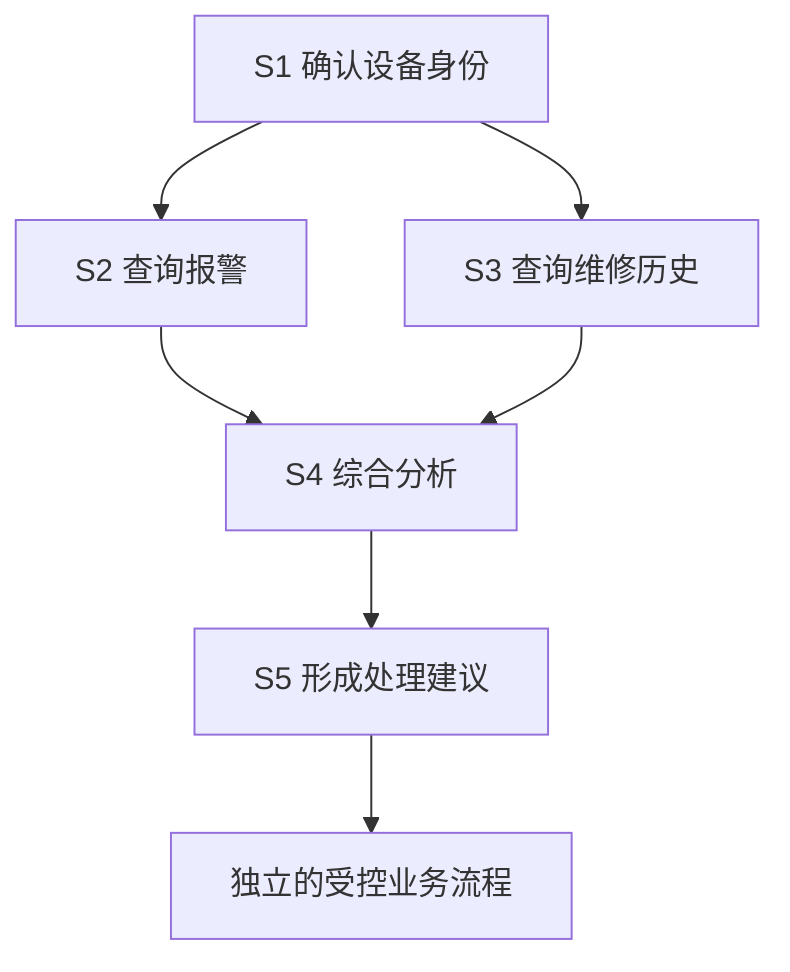

# 模块 04 · 第三讲：Agent Planning 与任务分解

[总目录](../../README.md) · [模块目录](../04-agent-tools.md) · [上一讲](02-react.md) · [下一讲：工具工程](04-tool-engineering.md)

**来源**：原聊天第三讲正文、DAG 调度演示及 4 道原课检验，2026-11-06 核对。本文重写整理，不要求实现调度器；新增推演明确标注。

## 1. 规划要解决目标遗漏与依赖问题

“调查重复报警、整理历史、必要时报修并反馈”包含多个子目标。纯粹走一步看一步可能遗漏维修历史、过早结束，或把尚未授权的建议直接执行。

Planning 把目标变成结构化、可跟踪、可验证的计划。它不仅让模型考虑得更全面，也让程序能够校验、调度、恢复和审计复杂任务。

ReAct 更关心当前下一步做什么，Plan-and-Execute 更关心整个目标要覆盖哪些步骤。二者都不能保证模型无误，也可以结合使用。

## 2. 自然语言清单为什么不足

“查设备 → 查报警 → 分析 → 建单 → 回复”看似完整，却未说明分析依赖什么、空结果如何处理、是否必须建单、由谁批准、哪一步能并行，以及怎样证明完成。

原课结构化计划包含目标、步骤 ID、步骤类型、依赖和输出。生产语义还要明确输入引用、完成条件、风险、重试及预算约束。

**补充解释：**计划是提议，执行记录是已经发生的事实。不能让 Planner 每次重写计划时顺便把旧步骤的状态改掉。静态定义与运行历史应独立保存。

## 3. 设备调查的依赖图



S1 是共同前提；S2、S3 可以并行；S4 需要所需结果齐备；S5 输出建议而非自动授予建单权限。

如果这张图由程序预先定义，它仍是 Workflow。Agent 的部分价值是按目标和反馈生成、选择或调整计划，执行依赖图的调度器本身可以完全确定。

## 4. DAG 校验是程序责任

DAG 是有向无环图。若 S1 依赖 S2、S2 又依赖 S1，没有起点，调度无法推进。模型提出计划后，至少校验：

- Step ID 唯一，引用存在，无循环依赖。
- 工具和步骤类型属于允许集合。
- 输入输出类型匹配，引用路径可解析。
- 节点数量、依赖深度与总预算在范围内。
- 有副作用的动作具备明确授权和执行流程。

**补充解释：**通过拓扑校验只证明依赖结构合法，不证明计划满足用户目标。一个无环计划仍可能漏掉历史维修、使用错误时间范围或把客户 A 的对象传给客户 B 的步骤。结构校验和业务验收要分开。

## 5. Ready 不等于可以无条件执行

原课的简化规则是：PENDING 步骤的全部前置步骤成功后，进入 READY；Worker 领取后转 RUNNING，完成后更新输出与状态。

| 层次 | 检查什么 |
|---|---|
| 依赖就绪 | 前置步骤是否完成 |
| 业务可接受 | 输出是否足以满足后续需求 |
| 授权可执行 | 当前身份、对象和审批是否仍有效 |
| 调度可领取 | 是否被其他 Worker 领取，资源是否允许 |

查询报警成功返回空集，在技术上可能 SUCCEEDED，但无法据此确认“设备无故障”。数据可能未覆盖目标时段，或设备离线造成无新记录。

多 Worker 不能仅靠“先读 READY 再执行”防重复，需条件更新、事务或租约等领取控制。租约过期后仍可能重试，业务幂等依然必要。

## 6. 输出引用如何传给下游

原课把“从 S1 获取设备 ID”改为结构化引用。示意如下，不是任意框架通用报文：

```json
{
  "step_id": "S2",
  "type": "QUERY_ALARMS",
  "depends_on": ["S1"],
  "inputs": {
    "device_id": {"from_step": "S1", "output_path": "$.deviceId"}
  }
}
```

执行器核验来源步骤、输出 Schema、字段格式和资源权限后再传参。不能把模型生成的“表达式”直接当可执行代码运行；应使用受限引用语法。

**新增推演：**S1 返回两个候选设备而非一个 deviceId，S2 应进入澄清或失败分支，不能擅自取第一个。输入引用正确解析，与业务对象已被唯一确定，是两项不同检查。

## 7. Replanning 的触发条件

原计划准备分析历史报警，却发现设备已更换模块或离线。前提发生变化，可能需要增加通信检查并调整比较时间窗口。

适合重规划：必要数据不可得、目标覆盖不足、重要证据改变方向、环境或预算条件明显改变。短暂 503、普通等待或可由执行器确定性重试的错误，不必每次都调用模型重写整个计划。

重规划消耗额外 Token 和时间，也会增加计划摇摆。应先说明哪条前提失效、哪些步骤受影响，再调整后续路径，而不是遇到任何异常就全量重来。

## 8. 已执行副作用不能被新版计划抹掉

原课例子：建单已成功，通知负责人失败。Planner 重新生成“建单 → 通知”时，不能把新计划当全新任务重新建单。

应保留 Step ID、计划版本、执行状态、operationId、真实输出及副作用状态。新计划可以改变未完成工作，已经发生的动作要以业务事实继续处理，必要时明确补偿。

**补充解释：**若新计划使用不同步骤 ID 表达同一个建单意图，单靠 Step ID 去重可能失效。业务操作身份需要稳定映射，而非完全依赖 Planner 随机生成的标签。

| 修改内容 | 合理处理方向 |
|---|---|
| 增加一个只读查询 | 校验新依赖和预算 |
| 改变尚未执行的查询顺序 | 重新校验数据依赖 |
| 修改已批准操作金额 | 原批准不能自动覆盖新参数 |
| 删除已经成功的建单步骤 | 历史事实不能删除，转入明确后续流程 |

## 9. 计划与局部 ReAct 的组合

高层计划可以固定“确认设备、调查、形成建议、按规则执行、反馈”，调查内部允许 ReAct 根据观察找证据。这样既保留目标覆盖，也不必预先猜出全部查询。

简单查询直接工具调用，固定录入走 Workflow，多目标与依赖明确时考虑规划，未知故障用动态调查，高影响写入仍回到受控业务执行。选择取决于不确定性、持续时间和费用收益，不是只看任务名称。

## 10. 原课 4 道检验与解析

1. 计划执行相比简单 ReAct 的主要优势是什么？
2. 模型生成循环依赖，系统该怎么办？
3. 一次 503 是否必然触发全量重规划？
4. 原建单成功，重规划时怎样处理？

<details>
<summary>展开答案</summary>

1. 明确依赖、并行关系及完成进度，不保证模型不出错。
2. 程序拒绝非法计划并要求修正，不能等待自动解决。
3. 不一定，优先使用受控重试、超时和熔断等确定性机制。
4. 保留真实结果与稳定操作标识，调整尚未完成步骤。

</details>

**新增面试追问：**怎样判断计划完成？不是所有节点都写了 SUCCEEDED，而是用户目标、必要产物、权限和真实业务结果均通过验收；跳过步骤也应有明确理由。
