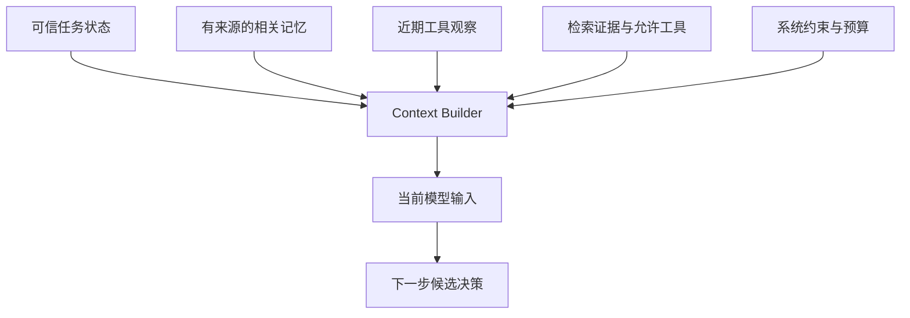

# 模块 04 · 第五讲：Agent Memory 与 Context Engineering

[总目录](../../README.md) · [模块目录](../04-agent-tools.md) · [上一讲](04-tool-engineering.md) · [下一讲：HITL](06-hitl-reliability.md)

**来源**：原聊天第五讲正文、上下文预算演示与 5 道检验，2026-11-06 核对。本文为课程重写，保留案例与数据治理边界，新增解释单独标注，不要求编码。

## 1. 保存了什么，不等于本轮看到了什么

Agent 连续调查 30 轮，可能收集数百条日志、十几份文档。数据库可以保存全部历史，但单次模型调用只应接收完成当前决策需要的信息。

Context Engineering 是在有限预算下选择相关、可信、及时且允许使用的输入，而不是尽量塞满窗口。选择过程可由检索、规则、摘要和模型共同完成，不必全交给 LLM。

## 2. 四个概念各有生命周期

| 概念 | 主要问题 | 例子 |
|---|---|---|
| Context | 本轮模型能看到什么 | 指令、当前问题、证据、工具定义 |
| Short-term Memory | 当前任务需要保留什么 | 已确认设备、近期发现、未解问题 |
| Long-term Memory | 跨任务值得复用什么 | 历史事件摘要、稳定偏好、验证过的经验 |
| Workflow State | 程序执行到哪里 | 步骤、审批引用、operationId、重试状态 |

“工单好像已创建”不能代替包含工单 ID 和操作状态的可信记录。持久化消息只解决存储，仍需决定什么时候取回、如何校验及何时失效。

**补充解释：**短期和长期不只是保留天数差别，还涉及用途与作用域。某次任务的审批状态即使保存多年，也不是可跨任务复用的授权记忆。

## 3. 一次上下文的五层组织

原课建议逻辑上组织为：系统与策略、目标及任务状态、相关记忆、近期 Observation、必要证据与工具 Schema。它不规定必须用五条 API 消息。

目标、已完成步骤、当前问题、已验证事实、未解问题与禁止动作应清晰可查。事实仍应有来源，不能把模型摘要中的“可能”悄悄升级成“已确认”。

**新增推演：**用户最初要求“只调查，不修改”，20 轮后压缩上下文只留下“分析完毕，建议维修”，该约束便可能消失。关键限制应从可信状态重新注入，而非寄希望于摘要永远记住。

## 4. 长期记忆的类型与权威来源

原课借用三种分类：Semantic 表示事实知识，Episodic 表示过去事件，Procedural 表示操作规则与经验。分类帮助管理，不表示人类记忆机制被完整复制。

| 记忆内容 | 应优先核验的来源 |
|---|---|
| 设备所属客户、型号 | 设备台账或主数据 |
| 上次故障与维修经过 | 工单和维修记录 |
| 设备排查步骤 | 经审核的知识与规范 |
| 用户稳定偏好 | 用户明确表达及允许的保存范围 |

当前设备是否正常、用户是否仍有权限等动态事实，应查询权威系统。长期摘要可以提供线索，如工单 ID，不能替代实时核验。

## 5. Checkpoint 与长期 Store

原课将任务或执行上下文的恢复状态，与跨任务信息复用分开。LangGraph 的 checkpointer 与 store 也分别承担线程范围状态和线程外长期数据的持久化职责。[官方持久化说明](https://docs.langchain.com/oss/python/langgraph/persistence)

“有持久性”不意味着相同用途。Checkpoint 帮程序恢复下一步，长期记忆帮模型获得背景；仅保存 Context 也不能知道外部动作是否生效。

**补充解释：**内存实现的 checkpointer 或 store 与可跨重启存活的部署存储不同，实际故障恢复能力要看后端和保存契约，而不是类名。

## 6. Compaction 三种策略

| 方法 | 用途 | 主要风险 |
|---|---|---|
| Sliding Window | 保留最近若干轮 | 丢掉很早提出的关键限制 |
| Summary / Compaction | 用结构化摘要代替长历史 | 事实、条件与不确定性失真 |
| Tool Result Clearing | 移除旧的庞大工具原文，保留引用 | 缺少可追溯索引时无法复核 |

原课压缩例子：设备 40 字段、500 条报警、12 张工单、20 个检索片段和中间调查，压缩为目标、已核实事实、未确定项、下一步、证据引用和限制。

不能轻易丢掉原始目标、权限边界、已产生副作用的 ID、数值与时间、版本、未解异常和冲突。摘要不能替代原始审计日志，输入优化也不等于删除业务证据。

**新增反例：**“疑似线缆接触不良，尚未确认”压缩成“线缆故障已确认”，字数减少却改变了证据等级。评估不能只比较压缩率，还要检查限定词与支持关系。

## 7. Token 预算是阶段性的资源分配

原课假设单轮输入预算 16,000 Token，固定开销 4,000，历史 5,000，证据与记忆 4,500，共 13,500，余 2,500。这是应用预算，不是某模型最大窗口。

实际还要按模型约束预留输出、协议及必要安全余量。预算没超不代表输入全都相关；处于调查阶段时证据更重要，澄清意图阶段近期对话可能更重要。

**补充解释：**工具描述也占输入。一次性暴露 100 个工具，即使没调用，也可能挤掉关键证据。上下文治理与工具候选集设计因此相关。

## 8. 长期记忆检索与 RAG

技术上两者都可使用 Embedding、索引、检索与上下文注入。但来源和治理不同：企业文档知识、用户偏好、历史事件与模型推断不能混入无来源的大集合。

记忆应附 memoryId、租户、主体、类型、来源、时间、版本、有效期与访问规则。`VERIFIED` 不能由模型自评后自然成为可信等级，应来自校验或审核。

若工单被更正，派生摘要也可能要失效。系统应支持修改、删除、去重与过期，防止错误跨任务长期传播。

## 9. 五类风险与评估

原课风险为记忆污染、过期记忆、错误摘要、跨用户或租户泄露、无限增长。解决方向不是简单加更大向量库，而是来源、写入策略、授权、版本和生命周期控制。

评估可比较完整历史、滑窗、摘要加近期观察、摘要加记忆检索等策略，观察任务成功、关键事实与限制保留、恢复正确性、输入成本、过期引用与跨任务泄露。

在第 20 轮中断再恢复，是纸上理解很有效的场景：原目标还在吗，已完成动作能否识别，能否找到证据，是否仍遵守授权？不应让模型只复述历史来证明任务恢复。

## 10. 原课 5 道检验与解析

1. Worker 重启，最重要的恢复依据是什么？
2. 旧记忆说设备已修复，现在问是否正常，优先做什么？
3. Compaction 最大的风险是什么？
4. 为什么不把 500 条原始报警永久塞进每轮 Context？
5. Task State 与 Context 是什么关系？

展开答案

1. 可信持久化任务状态与恢复信息，而非模型摘要。
2. 查权威系统当前状态，记忆只供背景。
3. 丢失或歪曲事实、限制及不确定性。
4. 成本与噪声高，应选必要证据并保留回溯途径。
5. 前者是可信执行依据，后者是模型当前可见投影，还可包含记忆与检索等数据。

面试可用一句话串起本讲：**持久化状态负责可靠运行，记忆负责可控复用，Context Builder 负责本轮选择。**
