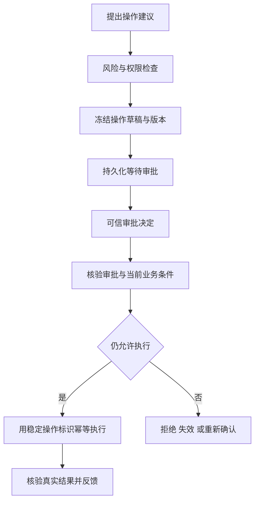

# 模块 04 · 第六讲：Human-in-the-loop 与可靠执行

[总目录](../../README.md) · [模块目录](../04-agent-tools.md) · [上一讲](05-memory-context.md) · [下一讲：安全与评估](07-security-evaluation.md)

**来源**：原聊天第六讲正文、300 元维修审批案例与 4 道检验；此前快照缺段，本批于 2026-11-06 从浏览器重新取得。本文为整理重写，不是根据课名推测补写。

## 1. 建议、批准、执行是三件事

Agent 调查后建议维修，客户负责人三小时后批准。期间设备可能修复、费用从 300 变 800、权限撤销，或已有同故障工单。旧批准是否仍允许此刻执行，是本讲核心问题。

模型建议是意图，人工批准是对特定操作的授权，业务系统执行才产生状态变化。三者不能互相代替。

HITL 不只是聊天确认，还包括 Approval、Clarification、Review：批准有副作用的操作，补足不明确的信息，复核高风险或低确定性结论。不同用途对应不同控制点。

## 2. 正确的执行链路

审批前冻结意图，确保人知道批准什么；审批后复核环境，避免批准被用于过时或已变化操作。先执行再确认无法获得同样的控制效果。

**补充解释：**不是所有写入都必须每次新增审批，是否需要由业务风险和既有授权策略决定。这里讨论的是业务规定需要审批时，系统怎样可靠落实。

## 3. Approval Snapshot 绑定什么

原课快照包含 approvalId、taskId、operationId、动作、参数、业务版本、参数哈希、状态与有效期。核心是把授权绑定到一项可核验操作。

| 绑定项 | 为什么不能缺 |
|---|---|
| 对象与动作 | 防止批准设备 A，却执行设备 B |
| 金额、范围等关键参数 | 防止批准 300，却执行 800 |
| 操作标识与版本 | 防止旧决定套到新草稿 |
| 审批人资格 | 防止仅凭知道 approvalId 就批准 |
| 有效期与撤销状态 | 防止无限期使用旧授权 |

哈希应基于规范化关键参数，用于比对变化，不替代原始业务对象或审批凭证。模型生成的 `approved=true` 不能取代审批服务记录。

## 4. 审批有效与业务仍可执行分别判断

| 三小时后的变化 | 处理方向 |
|---|---|
| 参数、身份和业务条件均未变 | 继续核验后，按原操作标识执行 |
| 金额变 800 | 生成新快照，按策略重新批准 |
| 设备已修复 | 原需求可能失效，不能机械建单 |
| 权限被撤销 | 不凭旧任务文本继续执行 |
| 已有同故障工单 | 判断复用、关联或阻止重复 |

“审批仍有效”不能代替“现在仍有必要”。设备仍需修理也不能代替审批有效。两种条件都要符合。

**新增推演：**复核价格后，另一事务立刻改价，仍有检查与使用间隙。关键条件应由下游以版本校验、条件写入或事务最终保证，不能只有 Agent 侧一次先查后写。

## 5. 持久化暂停与可靠唤醒

等待不应依赖长时间活着的 Controller 或 JVM 线程。保存 WAITING_APPROVAL、任务与操作引用，收到可信回调后再恢复调度。

原课审批回调把批准记录与恢复事件放进本地事务中的 Outbox，降低“审批已提交但唤醒事件未发出”的风险。Outbox 可能重复投递，消费者仍需去重和条件领取。

恢复通常是重新调度步骤，而非续接旧调用栈下一行。已完成草稿不应重新生成另一个身份不同的草稿。框架中的节点重放细节见[模块 05 第七讲](../module-05/07-human-in-the-loop.md)。

**补充解释：**后台定时检查审批也能结合持久化任务，不能把所有轮询都等同于占用线程。关键是等待事实可靠保存，重复唤醒不会重复产生业务效果。

## 6. 获批后超时，依然可能结果未知

批准只证明操作可执行，不能证明已经执行成功。工单数据库提交后丢失响应，应标记 UNKNOWN_OUTCOME，用原 operationId 查结果；确认成功则保存 ticketId，确认未执行时按幂等契约恢复，无法确认则暂停对账或人工处理。

不能把网络失败自动解释为业务失败，也不能让模型根据“已获批准”猜测成功。批准状态、执行状态、通知状态各有独立事实。

原课还强调稳定 ID 必须持久化，下游需要真正支持去重或业务唯一约束。调度层只让一个 Worker 领取，也不能解决后续租约过期或响应丢失造成的重复尝试。

## 7. 取消与补偿

Cancellation 阻止未执行动作，Compensation 对已发生业务效果执行受控反向动作。原课例子：已建单、已指派人员、尚未通知时取消，需要停止后续通知，并处理取消工单与撤销指派。

直接把 Agent 标记 CANCELLED 不会删除真实工单。补偿可能失败、需要审批，也未必消除已经发生的成本；它不是跨系统数据库回滚。

**新增例子：**维修员已经出发，撤销指派不能使交通时间和费用归零。系统应记录取消、补偿与未消除影响，而不是在语言回答中宣称“已完全恢复原状”。

## 8. 审批系统与通知渠道解耦

审批服务维护授权与快照，渠道负责把请求送给正确的人。可用渠道可能是后台或受控确认页面，但实际选择应依据已验证的平台能力。

能读取外部群消息，不应直接推断能发确认卡片并可靠接回调。核心可靠性不能建立在未经核实的发送路径上。若无自动通道，应保留人工处理与待办。

本讲是架构案例，不表示用户已经部署了这些入口，也不提供平台当前权限或合规条件的结论。

## 9. 状态机的关键间隔

原课操作状态从 DRAFT、WAITING_APPROVAL 到 APPROVED，之后还有 REVALIDATING，才进入 EXECUTING 和 SUCCEEDED；此外可能 REJECTED、EXPIRED、STALE、UNKNOWN_OUTCOME、FAILED、CANCELLED。

这些是教学枚举，不是通用协议。重要的是批准不直接等于执行，取消不直接等于已补偿，超时不直接等于未生效。每次转移需要明确触发者、前提和审计依据。

## 10. 原课 4 道自测与解析

1. 批准 300 元，现在变 800，如何处理？
2. 获批后创建工单超时，如何恢复？
3. 已建单并指派人员，用户取消，怎么办？
4. 为什么 APPROVED 后不能无条件 EXECUTING？

展开答案

1. 关键参数变化，按业务规则生成新操作快照并重新审批。
2. 原操作标识核验结果，同键幂等恢复，不生成新 ID 盲目重试。
3. 停止未执行步骤，并对已执行动作走受控补偿。
4. 身份、参数和业务条件可能变化，先复核，再由业务系统保证关键写入条件。

面试主线：**批准具体操作 → 持久化等待 → 可信恢复 → 当前条件复核 → 幂等执行 → 区分取消和补偿。**
