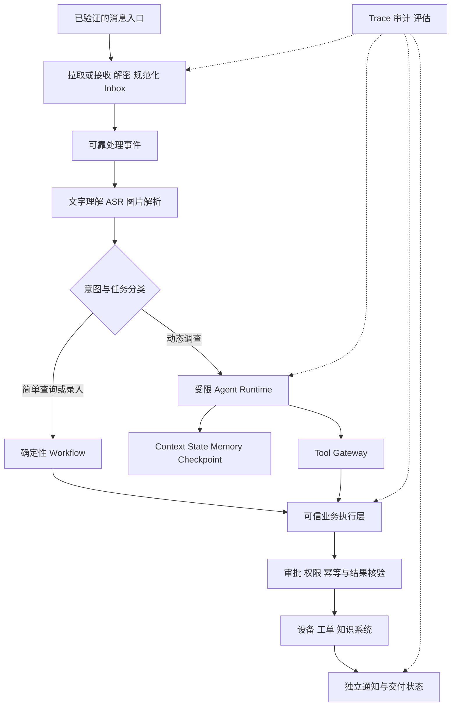

# 模块 04 · 第八讲：生产级 Agent 系统设计

[总目录](../../README.md) · [模块目录](../04-agent-tools.md) · [上一讲](07-security-evaluation.md) · [后续：模块 05](../05-orchestration.md)

**来源**：原聊天第八讲综合设计、分阶段建议、10 项验收检查与 4 道面试检验，2026-11-06 核对。本文是架构学习资料，不是用户项目的已实现说明，也不要求开发。平台接口、范围及发送许可需按实际环境另行核实；本页不提供其最新能力或法律结论。

## 1. 先界定入口与反馈能力

原课场景是客户以文字、图片或语音请求查询设备、调查故障、必要时建单并得到反馈。最关键的边界是：能够读取某渠道的消息，不等于可以通过同一能力自动回复原会话。

消息读取、媒体获取、身份关联、审批入口、发送通道与回执语义应分别验证。未验证的回群能力不能画成已经可用的接口，设计中应保留后台待办或人工反馈路径。

这影响的不只是 UI，也影响任务完成标准：工单已创建、通知已提交、平台已接收、用户已阅读不是同一事实。

## 2. 总体架构按职责拆分

这是逻辑职责，不强制拆十几个微服务。原课建议先以模块化应用加异步 Worker 理解，再按吞吐、故障隔离和团队能力决定部署。

## 3. 消息接入：先可靠保存，再确认进度

原课按游标拉取场景讨论：若先推进持久化游标，再保存本批消息，落库失败后可能漏处理。应让原消息接入记录与对应进度在合理的本地事务边界内可靠保存，再通过 Outbox 发处理事件。

Inbox 以来源和稳定消息标识作唯一约束，允许重复接收而不生成重复逻辑消息。Outbox 解决本地提交与事件派发之间的窗口，不使 MQ 自动获得端到端 Exactly-once；消费者仍需幂等。

**补充推演：**一批中某条解密或媒体处理失败，不能直接当作业务成功跳过。应按系统契约保存可追踪失败、可重试原始引用或停止推进相关确认进度，避免失败消息随游标永久丢失。具体获取窗口和恢复能力要按真实平台核实。

消息已保存只表示接入成功，不等于媒体已理解、任务已完成。应区分接收、解析、任务创建、处理中、完成与失败。

## 4. 多模态输入统一结构，保留来源

文字、语音、图片可以进入统一的规范化消息对象，包含 messageId、conversationId、sender、正文、附件引用和提取事实。

但 ASR 转写或 OCR 报警码不是用户亲口确认的事实，应保留来源类型、附件引用和校验情况。模型自报置信度不能直接视为校准后的准确率。

**新增例子：**图片识别 E102、语音说 E120，不能任意取一个继续操作。保留冲突，结合权威设备数据或请求澄清。原始附件可回溯，避免摘要掩盖识别错误。

ASR 与视觉能力适合通过独立 Adapter 统一结果及错误语义，供应商变化不应迫使任务主流程重新定义全部状态。

## 5. Router 决定路径，不决定权限

| 用户意图 | 原课优先路径 |
|---|---|
| 查设备当前状态 | 单次受控工具 |
| 按固定字段生成报修草稿 | Workflow |
| 调查反复报警原因 | ReAct |
| 汇总故障并形成多步方案 | Planning 加局部调查 |
| 正式建单或修改业务状态 | 受控业务流程 |
| 目标不明或对象不唯一 | 澄清与等待输入 |

Router 可生成 intent、executionMode、entities 和 missingFields。但风险级别来自服务端策略，模型把删除分类成 READ_ONLY 也不能放行。

“又坏了”而当前会话有多台设备时，不应强猜实体。没有自动沟通通道也可以生成后台待补充任务，不能将“需要澄清”伪装成已经问到客户。

## 6. 一条复杂请求的六个阶段

原课请求是“12 号设备又报警，像上次一样；若还没解决就安排维修”。下面数据均为教学示意。

### 阶段一：接入并创建任务

以稳定 messageId 保存消息，创建 taskId 并记录事件。重复消费返回既有任务。不能只靠先查再插判断不存在，应以唯一约束或相应原子机制应对并发。

### 阶段二：理解目标与对象

关联可信发送人和客户范围，提取设备短编号与条件性需求。客户说“需要维修就安排”不自动授予系统任意费用和设备修改权限。

### 阶段三：动态调查

查询台账、报警、历史和知识，形成有证据的判断。模型可提出待查信息，但是否符合正式建单条件仍由业务规则核验。

### 阶段四：准备具体业务操作

创建 operationId、冻结设备、故障、金额或范围及版本，按策略等待审批。这是一项具体操作，不是给 Agent 长期通行证。

### 阶段五：复核与执行

审批后检查资格、对象、参数、设备是否已修复及是否已有同类工单。用稳定标识幂等执行，取得真实工单 ID；超时进入结果未知处理。

### 阶段六：反馈与交付

生成来自真实结果的反馈。通道不可用或发送失败时，保存通知待处理，不重新建单，也不宣称客户已经收到。

## 7. 至少区分三类状态

| 状态对象 | 关注点 | 示例 |
|---|---|---|
| Agent Task | 调查与协调进展 | RUNNING、WAITING_APPROVAL、COMPLETED |
| Business Operation | 真实业务动作 | DRAFT、EXECUTING、SUCCEEDED、UNKNOWN_OUTCOME |
| Notification | 结果是否完成交付 | PENDING、SENDING、SENT、FAILED |

这些是示意枚举，不是所有系统的完整集合。业务成功、通知失败是可以同时成立的组合，应分别统计和恢复。

**补充解释：**任务是否算完成取决于业务验收定义。若目标包含可靠交付通知，可以保留“业务已完成、交付待处理”的聚合状态；不能一概把工单创建就算整个端到端目标完成。

## 8. 三层重复风险与领取机制

| 层次 | 重复来源 | 控制方向 |
|---|---|---|
| 接入 | 重复拉取或回调 | Inbox 唯一标识 |
| 调度 | 事件重复、并发 Worker、租约过期 | 条件领取、状态与恢复标识 |
| 业务 | 响应丢失、节点重放、重规划 | operationId、下游去重与结果查询 |

一个 Worker 成功领取任务不表示永远独占；租约过期后旧 Worker 可能尚在执行。**补充推演：**必要时用执行令牌或版本策略控制旧执行者，但具体机制取决于下游契约。无论调度如何做，业务幂等不能被省掉。

## 9. 故障应有明确状态

原课按接入、媒体、LLM、Tool、业务写入、审批、Worker、通知分类。处理分别为游标与积压监测、异步恢复、限流预算、错误分类、幂等查询、快照有效期、恢复调度和待办重发。

关键原则是失败可识别、可恢复或安全停止，而非假设所有组件永远不失败。禁止权限不足仍不断重试，也不要把预算停止包装成完整诊断。

## 10. 观测端到端瓶颈

关联 messageId、taskId、traceId、operationId，才能把接入、调查、审批、写入和通知连起来。

原课例子：拉取 15 秒、转写 3 秒、调查 20 秒、审批 30 分钟、建单 2 秒、通知再等 1 分钟。单次模型快 200ms 对整体改善很有限。应分别看计算耗时、排队和人工等待，不只看 LLM 延迟。

指标分入口积压和解析失败、Agent 成功与用量、工单重复和审批等待、通知提交和人工待办。完整原文可能包含敏感内容，Trace 保留字段、权限和期限应明确。

## 11. 原课 10 项验收清单（学习用）

- 重复消息不创建两个逻辑任务。
- 接入进度提交失败不导致已确认消息丢失。
- ASR 失败可追踪和恢复。
- 无权限用户不能访问其他客户设备。
- 恶意知识内容不能转化为越权执行。
- 过期审批不能继续生效。
- 建单超时不重复写入。
- Worker 恢复不重复产生已完成副作用。
- 发送失败不伪装成已送达。
- 达到预算能安全停止。

本表是原课的设计验收项目，不表示用户系统已通过测试。本次仅整理资料，不执行开发或生产测试。

## 12. 分阶段设计与原课自测

原课落地路线依次是可靠消息闭环、只读调查 Agent、带审批的业务写入、反馈与质量治理。当前用户优先扫盲，可以把它作为架构推演路线，而非需要立刻完成的项目清单。

原课 4 题：

1. 能读取外部群是否证明能用同接口自动回复？
2. 接入重复、任务重复、工单重复该如何处理？
3. 建单成功、通知失败如何记录？
4. 为什么不授予全部业务 API 权限？

展开答案

1. 否，发送通道和权限需独立核实。
2. 接入、调度和业务执行分别建立状态与幂等边界。
3. 保留业务成功与通知待处理，按交付策略重试或人工跟进。
4. 按最小权限，并由可信执行层核验任务、身份、资源和审批。

**新增综合练习：**画出一次语音维修请求，模拟“转写正确、建单响应丢失、通知不可用”。分别写出三类状态、恢复入口与允许的用户反馈。能明确哪里成功、哪里未知、哪里待处理，才真正理解这套系统。
