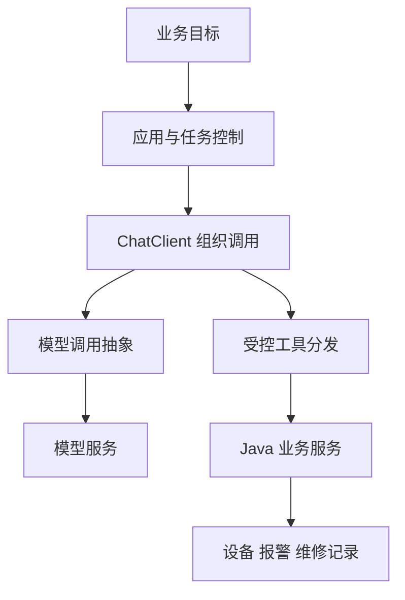
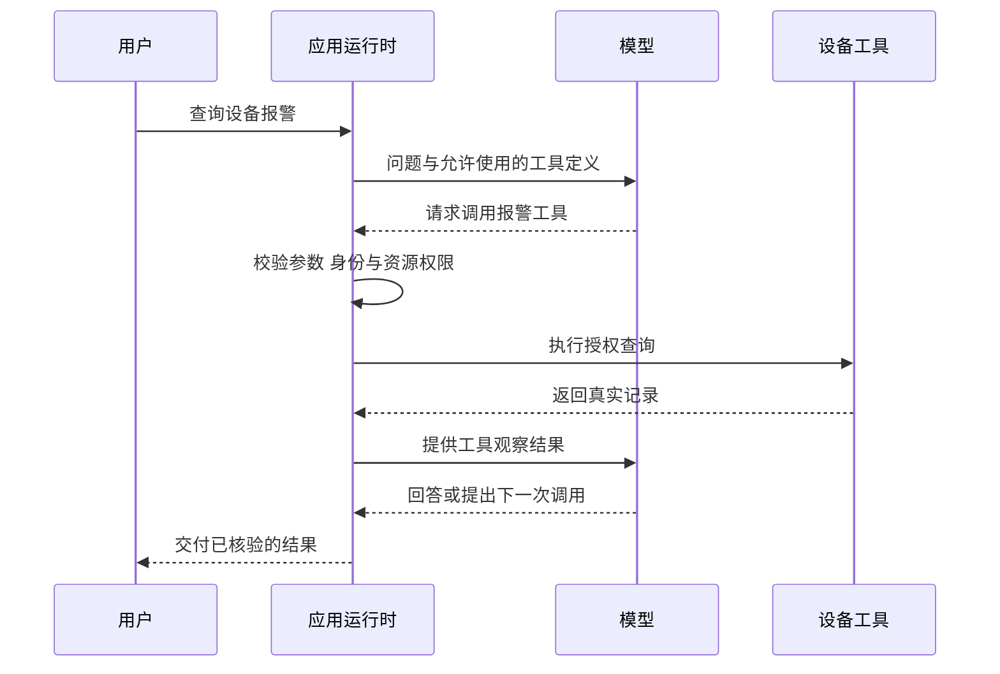

# 模块 05 · 第一讲：Spring AI 与 Agent 框架实战入门

[总目录](../../README.md) · [模块目录](../05-orchestration.md) · [下一讲：调用链](02-tool-calling-internals.md)

**来源**：原聊天《AI应用工程师面试题》，2026-11-06 通过浏览器向前加载取得第一讲正文及随后学习方式调整。原课标题包含“实战”，但用户随后明确要求先扫盲、后结合个人项目实践；本资料按原理笔记整理，项目只是教学案例，不要求编码，不代表已实现。本文为重写，新增内容标为“补充解释”。

## 1. 从“会调用模型”到“模型会选择工具”

普通模型调用给模型一段文本，再得到回答。设备业务的问题不同：用户问“12 号设备最近是不是又发生上次的故障”，答案必须依赖真实设备、报警与维修记录。

一种方法是在程序里固定查询三类数据，再让模型总结；另一种是提供受控工具，让模型根据当前信息决定查什么。后者具有基础 Tool-Using Agent 的特征，但还不等于生产任务运行时。

本讲的目标是说清：框架如何连接模型与 Java 工具，哪些对象分别负责什么，以及为什么一个自动工具循环还不够支撑审批与恢复。

## 2. Spring AI 与 LangGraph 的职责

Spring AI 将模型、Prompt、工具与检索等能力接入 Spring 应用。LangGraph 更关注用状态图表示任务的控制流、循环和恢复。它们是可以组合的不同职责，不是必须绑定的技术栈。

对于本课的第一阶段，模型能选择三个只读工具并根据结果回答，已足以理解核心闭环，无需先引入长期任务编排。等到出现等待审批、跨请求恢复和复杂分支，再讨论相应机制。

**补充解释：**Python LangGraph 的 API 不能直接当成 Java Spring AI API。跨语言调用、Java 中的图方案或已有流程引擎，都是另行评估的选择。逻辑分层图不意味着必须部署两个服务。

## 3. 核心对象按责任记忆

| 对象 | 原课中的定位 | 后端类比与限制 |
|---|---|---|
| ChatModel | 底层模型调用抽象 | 类似 Provider Client，不负责业务审批 |
| ChatClient | 组织 Prompt、参数、工具和响应的调用门面 | 类似高层调用入口，不是完整任务引擎 |
| Advisor | 在调用链上增强或处理交互 | 可类比拦截器，但可能参与多轮模型调用 |
| ToolCallback | 工具定义及执行契约 | 类似注册的 Handler，不是任意代码执行权限 |
| ToolCallingAdvisor | 本课 2.0 语境下的工具循环控制 | 管理模型与工具的多轮交互 |

版本边界：原课采用 Spring AI 2.0 机制。2026-11-06 核对的官方工具文档也将工具循环描述为 Advisor 链中的组成部分。不要把旧版模型内部循环的说明与新机制混用。[官方工具调用](https://docs.spring.io/spring-ai/reference/api/tools.html)

本资料不锁定依赖版本或给出可运行工程；落地应统一 BOM，并检查目标 Spring Boot 与 Spring AI 发布线的兼容性。

## 4. 一次工具调用闭环怎么发生

假设工具叫 `getRecentAlarms`，接受设备 ID，返回报警记录。真正发生的是：应用将工具的名称、用途与参数结构提供给模型；模型生成工具调用请求；应用解析并核验；真实 Java 服务执行；结果作为观察回到模型；模型决定继续查询或回答。

模型没有获得直接访问数据库的能力，它给出了一个动作请求。应用才是实际执行者。这一边界使执行层能够拒绝不存在的设备、越权资源、无效参数或不符合阶段约束的动作。

图是机制示意，不能从它推断具体线程、并发或事务边界。模型也可能不调用工具直接回答，是否允许要由任务要求及验证策略判断。

## 5. DeviceOps 教学案例：三个只读工具

原课提出一个 Mock 设备调查案例，先不接真实企业消息，也不做写操作。工具职责为：

| 工具 | 输入与输出意图 | 为什么需要 |
|---|---|---|
| findDevice | 设备编号 → 授权范围内的全局设备 ID | “12 号”可能不是全局唯一 |
| getRecentAlarms | 全局设备 ID → 最近报警 | 获取当前现象 |
| getMaintenanceHistory | 全局设备 ID → 历史维修记录 | 比较历史事实 |

找到设备后，报警和维修查询可能无数据依赖；但“先确定设备身份”仍是它们的前提。多个 Tool Call 是否并发由执行器和配置决定，模型提出多个调用不等于已并行执行。

### 可信身份不能让模型自己填写

用户说“查客户 A”，不代表该用户有权查看客户 A。服务端应从登录身份、租户关系和授权记录建立可信范围。设备编号只负责定位候选对象，不能承担授权证明。

原课提到 ToolContext 可用于携带不对模型暴露的执行上下文。应理解其目的：让可信身份和业务数据参数分离；不能推导为“只要放在 ToolContext 就已经验证过权限”。

### 工具描述是一份行为契约

描述应指出用途、参数含义、前置条件和只读或写入性质。例如报警工具要求全局设备 ID，就应提醒不能把短设备编号当作 ID。描述能帮助模型正确选择，却不能代替服务端校验。

## 6. 报警相同与根因相同不是一回事

Mock 数据为：DEV-0012 最近一周出现三次 SENSOR_TIMEOUT，上周曾检查通信线缆后恢复，本次根因尚未确认。

用户问是不是“上次那个故障”，至少包含两层含义：报警类型是否相同，根因是否相同。现有数据支持前者，尚不足以证明后者。

合理的回答应说明报警类型与历史一致、上次检查过线缆，并明确本次仍需进一步核实。直接断言“线缆再次损坏”超出了证据。

**补充解释：**模型可以正确使用三个工具，却仍因推理跳跃答错。因此 Agent 评估不能只检查工具是否被调用，还要检查结论与证据的支持关系。成功读取数据与成功完成调查是不同验收层次。

## 7. 自动工具循环与受控任务执行

自动循环让框架处理模型请求工具、执行、回传和再次调用，适合先理解只读查询闭环。若任务包含预算、审批、暂停、恢复或业务写入，就必须明确每一步由谁控制。

| 自动循环带来的便利 | 仍需设计的内容 |
|---|---|
| 减少重复请求与结果拼装逻辑 | 用户与租户授权 |
| 将工具结果送回模型 | 高影响操作的确认策略 |
| 多轮模型调用直到停止 | 总时限、轮数、费用上限 |
| 统一部分执行机制 | 进程崩溃后的状态恢复 |
| 简化原型调用入口 | 幂等、副作用核验与补偿 |

一次 `.call()` 从应用代码看很短，内部却可能调用模型多次。工具循环结束也不表示工单真实创建成功；最终要检查业务结果。

“自定义执行”不一定意味着从头重写框架。可以使用目标版本提供的扩展机制，或把业务控制放在外部任务系统中，前提是知道控制点究竟覆盖哪一层。

## 8. 按用户要求改成纸上验收

原课第一讲一度提出 Java 项目和 8 项 MVP 验收，随后用户明确要求暂缓实战。本次不复刻项目作业，改成概念检查：

1. 能画出模型提出调用、应用真正执行的边界。
2. 能区分 ChatClient、ChatModel、Advisor 和工具契约。
3. 能说明设备编号为什么需要可信客户范围。
4. 能按依赖关系排列三种只读查询。
5. 能区分现象重复与根因确认。
6. 能列出不存在、无权限、工具失败与证据不足的回答路径。
7. 能解释一次应用请求可能包含多次模型调用。
8. 能说出自动循环没有覆盖哪些生产机制。

这是一份新整理的学习检查表，不是原课项目测试结果。

## 9. 新增自测与解析

**题 1：用户说“客户 A 的 12 号”，模型传入客户 A，是否足够执行？**

不够。客户信息只是请求内容，必须用服务端可信身份校验对象归属与访问权限。

**题 2：模型连续调用三个工具，是否说明拥有长期任务恢复能力？**

不能。多轮工具交互发生在执行过程内；跨进程恢复还需要持久化状态、执行位置与副作用契约。

**题 3：两次 SENSOR_TIMEOUT，是否证明同一线缆故障？**

不能。相同报警可由不同原因引起，应说明证据支持范围和未确定项。

**题 4：一个节点不用 LLM，它还能放进 Agent 工作流吗？**

能。业务校验、工具请求和状态更新都可为确定性逻辑；不必让模型参与所有步骤。

面试表达主线：**先跑通受控工具闭环，再根据实际生命周期增加编排；模型决定候选动作，可信应用决定能否执行。**

继续阅读：[Spring AI ChatClient](https://docs.spring.io/spring-ai/reference/api/chatclient.html)。
