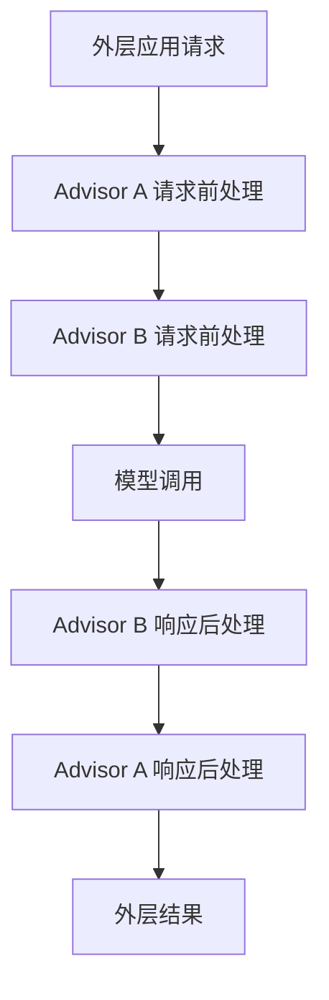

# 模块 05 · 第二讲：Spring AI 的架构原理与工具调用机制

[总目录](../../README.md) · [模块目录](../05-orchestration.md) · [上一讲](01-spring-ai-introduction.md) · [下一讲：状态与恢复](03-state-memory-checkpoint.md)

**来源**：原聊天第二讲正文与 5 道知识检验，2026-11-06 通过浏览器取得。按原课内容重写；示意顺序不是固定默认配置，不安排代码作业。原课依据 Spring AI 2.0，本讲同样按该版本机制理解。

## 1. Spring AI 封装的不是一个 HTTP 请求

模型供应商可能在请求结构、参数、流式事件、工具消息和异常上不同。应用可以自己写适配器，Spring AI 则提供与 Spring 生态结合的模型调用、上下文增强、检索和工具执行抽象。

统一抽象减少重复工作，但不能消除供应商差异。两个模型都能返回文本，不等于工具能力、输出格式、限流规则和可靠性完全相同。

本讲要追踪“一次 ChatClient 调用”的内部多轮行为，并理解 Advisor 的位置为何影响执行次数和观测口径。

## 2. 调用链上的职责

ChatClient 负责组织一次应用调用；ChatModel 负责向模型实现发送请求并取得结果；Advisor 在调用前后增强和处理交互；ToolCallingManager 负责具体工具分发执行；ToolCallback 表达工具契约。

在原课 2.0 语境中，ToolCallingAdvisor 驱动工具循环，模型适配器不承担全部循环控制。实际项目必须按使用版本查机制，不能把不同发布线的类名和行为拼在一起。[工具调用官方说明](https://docs.spring.io/spring-ai/reference/api/tools.html)

**补充解释：**“负责执行工具”是框架调度责任，不表示业务层可以省略授权、对象存在性和状态校验。调用 Java 方法的能力与操作业务资源的资格是两回事。

## 3. Advisor 的责任链

原课用 Memory、RAG 和工具循环示意：请求先恢复历史，再检索证据，再执行模型工具交互，最后将结果沿调用链返回。这个顺序是教学例子，实际按 Advisor 顺序与配置决定。

可以类比拦截器的嵌套：先进入的处理者往往后退出。顺序影响当前节点到底看到原输入、增强输入还是最终输出。不能仅看注册列表，假定每个 Advisor 在每轮都执行。

原课强调较小 Order 优先、同序不能依赖固定先后。若两个组件存在必须先后的业务关系，应明确定义，避免依赖碰巧稳定的顺序。[Advisor 文档](https://docs.spring.io/spring-ai/reference/api/advisors.html)

## 4. 一次用户请求可能有三次模型调用

设备调查示例：

| 轮次 | 模型得到什么 | 模型输出 | 运行时处理 |
|---|---|---|---|
| 1 | 问题及工具定义 | 查找 12 号设备 | 得到 DEV-0012 |
| 2 | 原问题与设备查询结果 | 查询报警、维修历史 | 执行两个查询并关联返回值 |
| 3 | 累积查询观察 | 回答现象及未证实根因 | 结束该工具循环 |

这里是一个用户请求、三次模型调用、三个工具调用。统计口径不同，数字就不同。它只是示例，不保证每个模型每次都按这个最短路径完成。

工具循环大致判断响应中是否仍有需执行的调用，执行后将观察送回模型。模型不再请求工具，意味着这轮循环可以结束，不表示业务任务自动验收通过。

**补充解释：**模型可能因能力不足、预算耗尽或误解提前给答案；也可能工具失败后仍生成流畅文本。真正的成功标准应依据任务要求及可信结果，而非“最终有一段自然语言”。

## 5. Recursive Advisor 为什么改变顺序的意义

原课将递归式 Advisor 理解为能够重新进入后续子链。假设：

`Memory → Tool Loop → Model`

Memory 在循环外，通常只处理一次外层请求；Tool Loop 可以多次进入下游 Model。不能把“工具循环多轮”理解为每轮重跑整个外层链。

换成：

`Tool Loop → Audit → Model`

则 Audit 位于重入的下游范围，可能每次模型调用都经过。是否还记录工具执行细节，要看 Audit 自身实现；放进下游并不自动观察所有真实业务操作。

| 位置与假设 | 观察粒度 | 可能用途 | 代价或遗漏 |
|---|---|---|---|
| 循环外的调用级观测 | 一次外层交互 | 用户请求耗时与最终结果 | 无法仅靠此计数推断模型轮次 |
| 循环内的模型级观测 | 多次模型请求 | 单次用量、延迟与错误 | 记录量更大，需关联外层任务 |
| 工具执行边界的观测 | 每次实际工具尝试 | 参数校验、权限、结果与副作用 | 需脱敏，重试应单独标识 |

原课提醒 Memory 放到内层可能引入重复读取、写入或上下文复杂度。具体会不会重复，由组件实现和配置决定，不能把“内层一定出错”作为通用规则。

## 6. 2.0 演进的架构含义

原课对比早期模型实现内部的工具循环与 2.0 Advisor 链上的循环：编排逻辑从底层适配中抽离，有利于统一观察和组合扩展。

学习重点不是背某个内部类的完整方法，而是看见框架如何拆分：Provider 适配负责差异，循环控制负责下一轮交互，工具分发负责真正执行，业务策略负责允许范围。

**补充解释：**框架的统一循环也不能统一所有业务结果。例如数据库查询空集、设备离线、权限拒绝、网络超时是不同状态，不应都转成“工具失败”交给模型随意猜测。

## 7. 多个 Tool Call 不等于并行执行

原课明确区分三件事：模型一次响应提出多个调用，框架能够解析多个调用，执行器实际并行运行。前两件成立，第三件仍取决于实现与配置。

报警与维修查询在取得同一设备 ID 后可能并行。建单与分配维修员则可能存在工单 ID 依赖，不能仅因模型一次提出就同时执行。

执行前应检查：输入是否来自已完成步骤，多个操作是否写同一资源，是否超出并发配额，失败时部分结果如何处理。工具批次不是自动正确的业务 DAG。

## 8. 工具发现与授权是两条链

原课用 100 个工具说明渐进发现：先找到与任务有关的少量工具，再提供给模型，而非始终把所有描述塞入上下文。它可以降低输入量与选择干扰，但也可能漏掉必要工具。

不能把“搜索结果”当成允许调用清单。工具发现回答“有什么可能相关”，授权回答“当前身份、任务和对象允许做什么”。无论工具来自本地注册、MCP 或其他能力发现机制，执行层都需复核。

**补充解释：**最好在暴露工具时尽量收窄范围，并在执行时再次校验；这两个控制点用途不同。隐藏工具不能替代后端鉴权，后端鉴权也不能消除将敏感工具描述无必要发给模型的风险。

## 9. 自动循环到完整 Runtime 还缺什么

| 能力 | 工具循环本身 | 业务系统还要明确 |
|---|---|---|
| 选择工具并使用结果 | 核心交互能力 | 选择是否满足任务需求 |
| 多步动态任务 | 可有多轮调用 | 任务状态和阶段合法性 |
| 跨请求或崩溃恢复 | 不可仅由一次调用推断 | 持久化、恢复标识与调度 |
| 审批 | 可集成相关步骤 | 可信审批、操作版本与有效期 |
| 幂等与补偿 | 不由循环自然提供 | 下游去重、未知结果查询 |
| 成功判断 | 循环可以停止 | 真实业务验收条件 |

不要用一个能力名称推断运行时全部保障。可靠任务需要机制组合，不只是把工具函数注册完。

## 10. 观测的四种计数

原课要求区分用户请求、模型调用、工具调用、完整任务。还可以在纸上进一步区分工具逻辑调用与实际网络尝试：一次逻辑操作有两次重试，实际请求次数可能更多。

建议用关联关系描述：taskId 下有 requestId，requestId 下有 modelCallId 和 toolCallId；产生业务效果的写操作还有稳定 operationId。具体命名可变，但不要把它们混成一个“调用数”。

**新增练习：**一次请求三次模型调用，其中第二次产生两个只读工具请求，一项因网络故障重试一次。可记录为一个外层请求、三次模型调用、两个该轮逻辑工具调用、三个实际工具尝试。若第一轮还有设备查询，则整个请求的逻辑工具数是三个、实际尝试四个。口径要覆盖全程。

## 11. 原课 5 道知识检验

1. 在本课 2.0 语境中，谁控制自动 Tool Loop？
2. ToolCallingManager 与 ToolCallingAdvisor 有何不同？
3. Advisor 放在循环内外可能改变什么？
4. 同轮两个 Tool Call 能证明并发吗？
5. 工具循环结束能证明业务成功吗？

展开答案

1. ToolCallingAdvisor。不要跨版本套用到所有实现。
2. 前者负责工具解析与执行调度，后者控制模型工具交互循环。
3. 可能决定每轮重入还是只处理外层请求，进而影响存储、成本与观测。
4. 不能，需检查实现和业务依赖。
5. 不能，必须验证真实业务结果与完成条件。

面试可用一条因果链表达：**一次应用入口可能触发多次模型推理；Advisor 位置决定哪些处理会重入；工具执行由应用负责；循环结束后仍需独立业务验收。**
