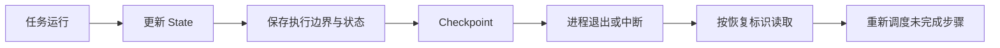
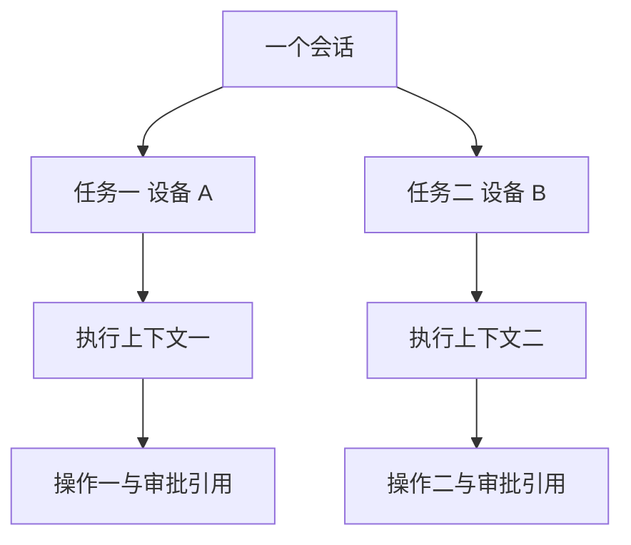

# 模块 05 · 第三讲：Agent State、Memory 与 Checkpoint 的底层原理

[总目录](../../README.md) · [模块目录](../05-orchestration.md) · [上一讲](02-tool-calling-internals.md) · [下一讲：图编排](04-langgraph.md)

**来源**：2026-11-06 从原聊天取得第三讲正文、设备维修案例与 5 道原课知识检验。本文重写整理，不是逐字讲义；新增解释独立标明。

## 1. 有聊天记录，为什么还是恢复不了任务

用户请求调查设备，必要时创建维修工单。Agent 已找到 DEV-0012、查询报警与维修历史、生成操作 OP-1001，并等待审批 APR-1001。此时服务重启。

如果只保存“用户提出维修请求”和“助手回复正在等待审批”两句话，恢复时仍不知道原操作参数、审批记录、哪些步骤完成、工具是否已执行，也不知道重复审批回调该怎么办。

这说明对话连续性与任务执行连续性是两个问题。前者帮助模型理解“它”指哪台设备，后者帮助程序决定当前是否允许继续、从哪里继续。

## 2. 先用四个问题分清概念

| 概念 | 回答的问题 | 典型内容 | 不应当作什么 |
|---|---|---|---|
| ChatMemory | 模型本轮需要哪些历史消息 | 用户问过的设备与此前回答 | 完整业务任务状态机 |
| Agent State | 任务现在知道什么、处于什么阶段 | 设备、目标、操作与审批引用 | 任意可信业务事实的替代品 |
| Checkpoint | 能按什么执行现场恢复 | 状态、执行位置、待处理工作与元数据 | 外部系统的事务快照 |
| Event Log | 过程中发生过什么 | 查询、审批、重试、写入等事件 | 自动具备重放语义的权威事件源 |

这些能力可以共用存储基础设施，但不能因为都放在同一数据库，就认为职责相同。

## 3. ChatMemory：保存与选择消息

第一轮用户说“查 12 号设备”，第二轮问“它上次何时维修”。应用把适当历史重新提供给模型，才能解释指代。记忆机制要决定保存、读取、裁剪哪些消息，Repository 则负责实际存储。

内存换成 PostgreSQL，改变的是消息持久化位置，不会自动补上业务执行位置、审批关联和操作结果。

原课还讨论窗口大小与工具消息存储的框架细节。这些依赖版本和具体 Repository，不应作为永久规则背诵。学习时应问：文本消息、工具请求与响应是否都被保留，是否成对，重启后是否可用，裁剪会不会破坏上下文。

**补充解释：**“保存了所有消息”也不意味着必须每次全部发给模型。存储完整性与上下文选择是不同控制点。历史里的过期批准、错误判断不应因被保存而获得新的业务效力。

## 4. Agent State：结构化且可验证的任务数据

原课状态示例按学习需要简化为：

```json
{
  "task_id": "TASK-1001",
  "device_id": "DEV-0012",
  "status": "WAITING_APPROVAL",
  "completed_steps": ["FIND_DEVICE", "GET_ALARMS", "GET_MAINTENANCE"],
  "current_step": "APPROVE_REPAIR",
  "operation_id": "OP-1001",
  "approval_id": "APR-1001",
  "plan_version": 2
}
```

它有三个特征：结构化，字段含义明确；可执行，调度程序能据此选步骤；可验证，操作与审批引用能关联可信记录。

但状态中的 `WAITING_APPROVAL` 或 `completed_steps` 仍需由可信执行逻辑维护。模型不能自行把“预计完成”写成已完成，也不能直接让 `APPROVED` 字段授予权限。

应尽量保留可复用的原始业务数据与引用，再按当前任务构造 Prompt。只存一段拼接后的 Prompt，会让后续筛选、校验和追溯变困难。

## 5. State 与 Checkpoint：内容与恢复机制

State 告诉你当前任务数据，Checkpoint 则把某个执行边界的数据与进度保存为可恢复现场。游戏角色背包可以类比状态，存档点可以类比恢复点；但恢复 Agent 不会让真实工单和外部系统一起回到过去。

恢复需要知道的不只是“设备是哪个”，还包括“哪些节点已完成，哪些任务待执行，恢复关联是什么”。具体快照包含哪些元数据由运行时决定。[LangGraph 持久化说明](https://docs.langchain.com/oss/python/langgraph/persistence)



### 保存频率的取舍

| 策略 | 可能收益 | 需要付出的代价 |
|---|---|---|
| 关键节点后保存 | 接近故障点恢复 | 更多写入与存储 |
| 定期保存 | 控制持久化开销 | 可能重做部分工作 |
| 等待前保存 | 适合审批或用户补充 | 不单独覆盖全部故障窗口 |
| 完成时才保存 | 实现简单 | 长任务运行中恢复弱 |

这是通用策略比较，不表示所有运行时都原样提供这四个配置项。同步、异步保存还涉及确认时点与丢失窗口，应按实际存储及版本核验。

## 6. 崩溃位置为什么决定处理方式

原课围绕创建工单给出三种位置：调用前、业务成功但保存前、Checkpoint 保存后。

| 崩溃位置 | 已知什么 | 恢复时不能忽略什么 |
|---|---|---|
| 发起调用之前 | 若能确认尚未请求，则无该次副作用 | 当前权限与审批可能已改变 |
| 下游成功、保存前 | 业务效果可能存在，图记录可能仍旧 | 通过稳定操作 ID 查询或去重 |
| 成功状态已可靠保存后 | 有已完成记录可供恢复参考 | 并发、通知和后续步骤仍有独立问题 |

最危险的是第二种：真实工单已建，但运行时不知道。重新生成新操作 ID 再建一次，会破坏去重。应使用原 operationId 核验下游结果。

持久化表示信息能存下来；Durable Execution 表示能够根据保存信息继续；业务幂等表示重复同一业务操作不会重复产生效果。三者互补，不能互相替代。

**补充解释：**网络超时常使结果“未知”，并非明确失败。日志写着请求超时，不足以证明工单不存在；应查询权威结果或进入对账，而不是让模型猜测。

## 7. Event Log：记录过程，不只是最终状态

原课事件线包括任务创建、设备识别、报警查询、草稿创建、审批请求、审批通过、业务复核、工单创建与通知待处理。

最终状态 `{COMPLETED, ticket_id}` 说明结果，无法完整解释中间为什么等待三小时。事件线可以回答哪步慢、何时重试、谁批准、通知是否仍待处理。

| 信息形式 | 强项 | 局限 |
|---|---|---|
| 当前状态 | 快速判断此刻如何处理 | 丢失过去转移细节 |
| Checkpoint | 从已保存边界继续 | 不保证外部世界可回滚 |
| 事件日志 | 回溯变化、审计和排查 | 可能不完整、不严格有序 |
| Event Sourcing | 将事件作为权威来源重建状态 | 需要完整契约、版本与重放规则 |

原课明确：普通 Trace 不等于 Event Sourcing。只写了若干日志，未定义顺序、完整性、去重和事件演进，不能承诺可靠重建状态。

**补充解释：**即使能用事件重建内部状态，也不应在重放时再次真实发送邮件或创建工单。恢复状态与重做外部动作必须分开设计。

## 8. 对话、任务与执行标识不能混用

原课用一个企业群里三个维修任务解释：conversationId 关联对话，taskId 关联业务任务，thread_id 关联图执行上下文，operationId 关联具体副作用操作。

它们可以存在明确映射，但不应未经设计就全部用群 ID。否则一次任务的审批、取消或恢复可能影响另一个设备请求。



图是示意，实际可能一个任务分多次执行，或一个执行包含多个业务操作；关键在关系清晰和隔离，而非固定一对一。

## 9. 什么时候需要独立编排

单次总结不必配置复杂任务恢复；连续聊天主要需要消息上下文；一次短请求中的几个只读工具可能只需有界循环与 Trace；跨请求调查、人工审批、多服务写入则需要持久化任务与明确的恢复机制。

判断顺序应为：生命周期是否跨请求或进程，是否可能等待，是否存在不可随意重试的副作用，然后再比较图运行时、业务工作流或自定义状态机。

不应由“用了大模型”直接推导“必须上 LangGraph”。同样，已有 ChatMemory 也不能推导“长期任务不需要状态系统”。

## 10. 原课 5 道自测与解析

1. PostgreSQL 保存聊天历史是否自动带来 Agent 任务恢复？
2. State 与 Checkpoint 的准确关系是什么？
3. 工单成功而 Checkpoint 未保存时如何恢复？
4. Event Log 与 Checkpoint 的主要区别是什么？
5. 同一群里多个独立故障请求如何隔离？

<details>
<summary>展开答案</summary>

1. 否，仍需任务状态、执行位置及副作用结果。
2. State 表达任务数据，Checkpoint 保存可恢复的状态和执行信息。
3. 用稳定操作 ID 核验或幂等重试，不用新 ID 再建单。
4. 前者记录发生的事件，后者关注可恢复快照；普通事件日志不自动成为权威状态源。
5. 区分会话与任务标识，每项任务维护独立状态及关联审批。

</details>

**新增追问：**删除会话记忆能否取消正在等待审批的任务？不能据此推断。对话消息和业务任务有不同生命周期，取消应走可信任务状态流程，并处理已产生的副作用。
