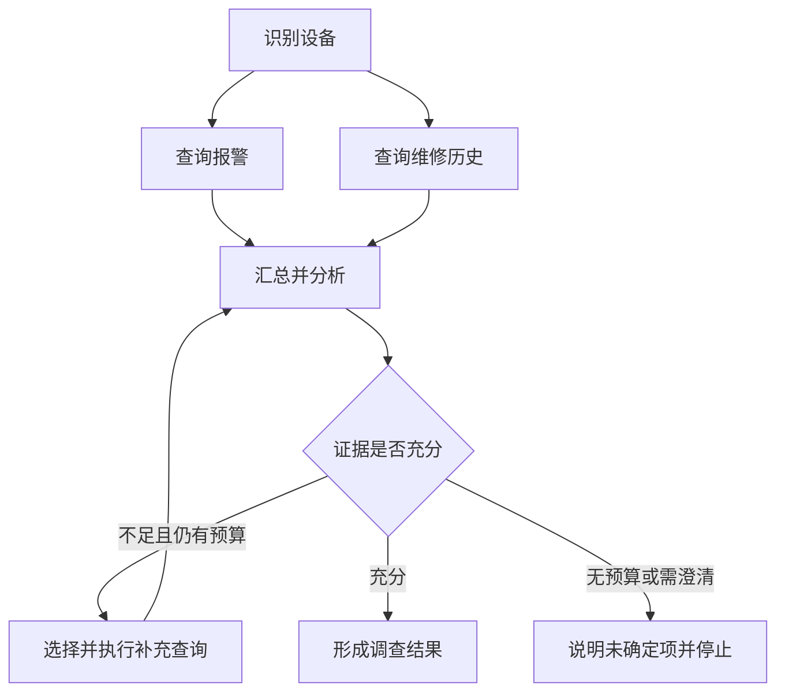

# 模块 05 · 第四讲：LangGraph 与图编排的底层原理

[总目录](../../README.md) · [模块目录](../05-orchestration.md) · [上一讲](03-state-memory-checkpoint.md) · [下一讲：MCP](05-mcp.md)

**来源**：原聊天第四讲正文、并行状态案例与 5 道知识检验，2026-11-06 取得。本文为原理重写，新增推演有单独标识；不要求安装框架或写项目。

## 1. 为什么把 Agent 表达成图

简单 ReAct 可以用“决策 → 工具 → 观察”的循环描述。故障调查加入多个并行查询、条件分支、审批等待与恢复后，仅看一串调用就难以理解完整控制关系。

图把工作步骤和转移规则显式化：Node 做工作，Edge 决定接下来去哪，State 在步骤之间传递数据。它不是把所有逻辑交给模型，而是允许确定性程序与模型决策在明确边界中组合。

传统代码当然能实现相同控制流。采用图是为了让复杂执行结构、状态与恢复边界更易管理，不是因为普通函数无法调用工具。

## 2. Node：产生状态更新的工作单元

节点可以做普通计算、业务校验、模型调用、检索、远程查询或等待。不是每个 Node 都需要 LLM。

原课用 `Node(S) → ΔS` 表示：节点读取当前状态，产生一部分更新。例如报警节点只返回 `alarm_history`，而不是重新生成整个任务对象。

**补充解释：**这有助于明确字段责任。若每个查询节点都返回一份旧的完整 State，可能覆盖其他并行节点刚写入的结果。局部更新也不意味着自动无冲突，仍需定义合并规则。

节点边界还关系到路由与恢复。把整个系统压成一个巨大 Node，会失去许多清晰的进度边界；拆得过细又可能增加存储与调度复杂度。应根据依赖、失败与重试需求划分。

## 3. State 与模型 Context 分开

图状态可以保存设备标识、完整报警历史、维修记录、诊断结果、审批引用和消息。某次模型调用只需其中相关部分。

例如 State 保存 100 条报警、12 张工单与执行事件，当前诊断只选择最近三次报警和最后一次维修。上下文构造节点负责筛选、压缩并保留关键条件。

保存更多 State 不等于每次给模型更多文本。前者服务任务执行，后者受预算、相关性与权限约束。敏感状态字段也不必暴露给模型。

## 4. Edge：预定义转移与条件路由

固定边适合已确定的后续步骤；条件边用路由函数根据 State 选择下一步。路由函数可读模型的结构化建议，但目标必须映射到允许的节点。

模型可以建议 `QUERY_TELEMETRY`，执行层应验证是否是合法选项、当前是否允许以及输入是否齐备。不能让任意生成字符串跳转到高权限写入节点。

**补充解释：**图示中的双分支汇合是业务依赖要求。真正实现时需明确等待两项完成再分析，不能把两条箭头当作对所有 API 都适用的隐式屏障语义。

## 5. Reducer：并行结果如何不互相覆盖

报警节点产生“发现三次通信超时”，维修节点产生“上周检查过线缆”，二者都写 `findings`。如果只覆盖，可能只留下一条；并发更新缺少适当合并规则，也可能触发冲突错误。

Reducer 表达 `新值 = R(旧值, 本次更新)`。列表可追加，集合可并集，标量可按版本覆盖；不是所有字段都适合同一种方式。

| 字段 | 期望含义 | 合并方向 |
|---|---|---|
| findings | 多来源发现 | 追加并按稳定标识去重 |
| messages | 可更新的消息集合 | 按消息标识合并 |
| completed_steps | 已完成步骤集合 | 集合并集 |
| current_device_status | 某时刻的当前状态 | 依可信版本或时间选择 |
| approval_status | 业务审批状态 | 可信状态机核验，不任意拼接 |
| total_cost | 唯一调用记录的总用量 | 对记录去重后聚合 |

审批是否通过不能靠两个字符串合并决定，费用也不能在重放时重复累加。Reducer 定义状态合并，不授予业务决策权。

## 6. 结合律、交换律与幂等性为什么有用

原课要求理解合并的数学性质，而不只记一个框架参数：

- 结合律：分组顺序改变时，结果仍一致。
- 交换律：输入到达先后改变时，结果仍一致。
- 幂等性：同一项更新重复到达，不重复生效。

集合并集适合表达不关心顺序且可去重的事实集合；列表拼接通常不满足交换律，`A+B` 和 `B+A` 顺序不同。业务要求稳定顺序时，应使用时间、序号或其他排序键。

**新增推演：**报警节点因重试再次提交发现 F1。直接追加得到 `[F1,F1]`，模型可能误读成两个独立证据。为发现附来源及稳定 ID，合并时去重，才能区别“重复事件”和“两个来源各自确认”。去重键也要符合业务语义，不能按相同文本抹去独立事件。

这些性质是设计目标，不能凭使用集合或 Map 就断言业务已经正确。版本、来源与覆盖规则仍需明确。

## 7. Super-step：理解调度轮次

原课把同轮可参与的节点组织成 Super-step。设备识别在前一轮完成，报警和维修查询可以在后一轮并行，再由后续分析消费结果。轮次不是每个节点独占一个线程，也不是外部业务事务。[Graph API 概念](https://docs.langchain.com/oss/python/langgraph/graph-api)

| 示例轮次 | 工作 | 前提 |
|---|---|---|
| 1 | FindDevice | 取得合法设备身份 |
| 2 | QueryAlarm、QueryMaintenance | 共同依赖设备 ID，彼此无数据依赖 |
| 3 | AnalyzeFault | 所需结果可用并完成合并 |
| 4 | RouteAction | 依据合法诊断状态选择路径 |

图可并行不等于业务可并行。创建工单与分配该工单人员有依赖，不能为了速度一起执行。多个节点同轮运行也不意味着它们的外部副作用原子提交。

## 8. DAG 与循环图

DAG 不允许环，适合明确依赖的任务分解。Agent 调查可能反复判断证据、查询工具、观察结果，因此需要条件路由和循环。

循环必须同时有业务停止条件与执行预算。业务条件包括证据充分、无法继续、需要澄清；预算包括最大轮数、总时限、工具次数和费用。

运行时步数上限可以防止部分失控，但不能替代业务判断：一轮里可能有多个昂贵调用，而重复查询虽未达上限也可能毫无进展。

**新增自查：**若两轮得到相同证据且没有新问题，应该继续查、换方法还是澄清？答案应依据证据缺口与剩余预算，而非“循环还没到最大次数”。

## 9. Command 与 Send

Command 类机制可以把状态更新与路由意图放在同一个返回结果中，例如写入诊断并转到准备维修。原课提醒混合静态边与动态路由可能意外激活多条路径，应让路由策略清晰。

Send 类机制适合按运行时数据动态派生同类任务，例如为 20 台设备生成分析输入，最后汇总。这类似 Map-Reduce，不要求预先为每台设备手写一个固定节点。

**补充解释：**动态分发不意味着必须用 20 个独立 Agent。可以是同一节点逻辑的多份输入；还需限制并发、费用与结果关联，确保某台设备失败不会被汇总成“全部正常”。

## 10. Checkpoint 与 Interrupt 的边界

图可能保存状态后等待外部审批，再按原标识恢复。恢复可涉及重入节点，因此节点副作用需要可重试、可核验。具体恢复语义见[第七讲](07-human-in-the-loop.md)。

判断采用图还是已有工作流，应看动态控制、长期等待、版本管理与运维需求。Spring AI 可负责模型工具集成，业务流程负责授权与写入，图负责复杂调查，三者可以分工。

本讲不声称图框架实现跨系统 Exactly-once，也不把 Checkpoint 当作业务数据库的替代品。

## 11. 原课 5 道自测

1. Node、Edge、State 分别做什么？
2. 并行节点更新同一列表但无合并规则，可能怎样？
3. 为什么图能表达 ReAct？
4. Send 适合什么任务？
5. 有 Checkpoint 是否还要业务幂等？

展开答案

1. 做工作、控制流向、保存共享任务数据。
2. 可能发生并发更新冲突或不符合预期的更新，不会自然按业务时间排序。
3. 支持条件转移与循环，不限定为 DAG。
4. 根据运行时数据动态分发多个同类子任务。
5. 要，外部副作用与图状态存在不同提交边界。

**新增面试题：**怎样保证并行查询结果稳定？先定义字段责任与依赖汇合，再选择合并语义，记录稳定 ID、来源和版本；需要稳定显示顺序时显式排序。不要靠节点恰好完成的先后顺序保证业务含义。
