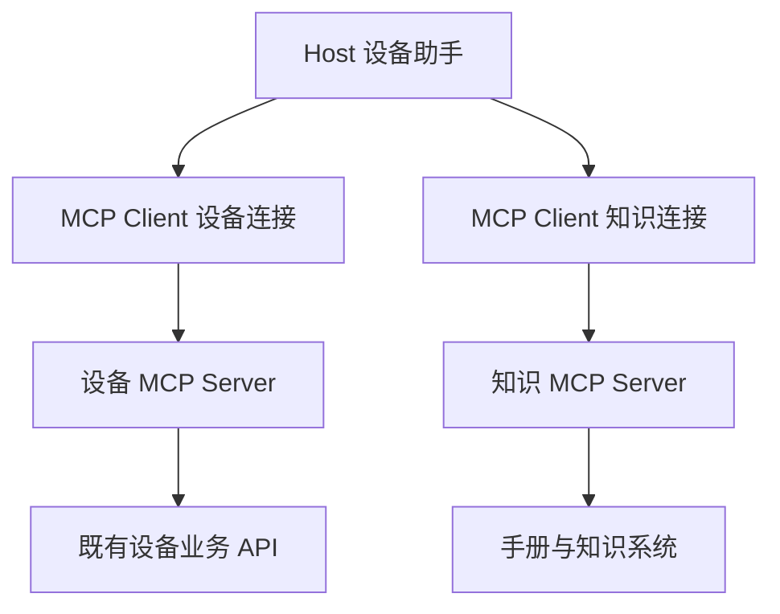
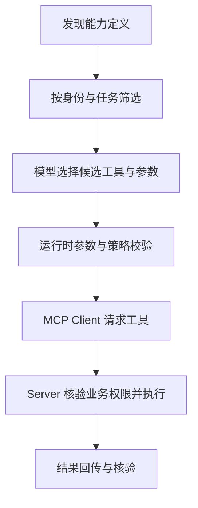

# 模块 05 · 第五讲：MCP 协议的底层机制与工具生态

[总目录](../../README.md) · [模块目录](../05-orchestration.md) · [上一讲](04-langgraph.md) · [下一讲：Multi-Agent](06-multi-agent.md)

**来源**：原聊天第五讲正文，2026-11-06 通过浏览器取得；原课的协议演进部分结合官方页面核对。本文重写整理，新增解释有标记。协议例子用于认识字段关系，不是完整 SDK 接入示例。

## 1. 已有 REST 与 RPC，为什么还需要 MCP

原课设定三个 AI 应用访问 CRM、ERP、IoT 和知识库。如果各自发明工具描述、参数和调用方式，最多有十二组独立适配关系。MCP 将 AI 应用发现和访问外部能力的契约标准化，使多个兼容应用能使用共同接入方式。

它不会自动生成全部业务适配器。设备 API 怎样映射为工具、查询身份如何传递、结果怎样解释，仍需提供方实现。收益是减少重复定义协议与接入约定，不是消除所有集成工作。

REST 可以继续作为 Server 背后的业务接口，HTTP 也可以继续承载 MCP 消息。二者处在不同层次，不能把 MCP 理解成“HTTP 的替代网络协议”。

## 2. Host、Client、Server

| 角色 | 承担的责任 | 设备场景 |
|---|---|---|
| Host | 承载 AI 应用、用户交互与能力使用策略 | 企业设备助手 |
| Client | Host 内的 MCP 通信组件 | 与设备能力服务交互 |
| Server | 提供工具、资源、模板等能力 | 包装设备查询与手册访问 |

一个 Host 可以连接多个 Server，通常由相应 Client 组件管理交互。Server 可以是本地进程或远程服务，不一定是大模型服务。



**补充解释：**“Client”是协议角色，不等于最终用户；“Server”是能力提供角色，不等于必须新买一台机器。角色、进程和部署节点是不同概念。

## 3. JSON-RPC：消息怎么表达

原课通过 `jsonrpc`、`id`、`method`、`params` 解释请求。`method` 表达协议操作，`params` 传参数，`id` 关联请求与响应。

下面保留原课的**字段关系简图式 JSON**，故意省略版本元数据、初始化或发现等前置交互，不能作为任意协议版本的完整合规请求：

```json
{
  "jsonrpc": "2.0",
  "id": 2,
  "method": "tools/call",
  "params": {
    "name": "find_device",
    "arguments": {"device_no": "12"}
  }
}
```

注意两层名称：`tools/call` 是协议方法，`find_device` 是具体业务工具。对方正确解析了 JSON-RPC，不代表设备存在、调用获授权或业务操作成功。

**补充解释：**请求 ID 用来关联一次协议交换，不自然承担业务幂等。重试建单时，新的 RPC 请求仍需携带同一业务 operationId；不能因为 RPC 的 `id` 不同就视为新业务操作。

## 4. 协议版本为什么必须注明

原课专门区分旧教程中的初始化握手与 2026-07-28 规范的无状态模型。2026-11-06 核对的[官方架构页](https://modelcontextprotocol.io/docs/2026-07-28/learn/architecture)也采用请求级版本与能力元数据，并通过 `server/discover` 提供能力、身份和支持版本的发现。

| 语境 | 应怎样理解 |
|---|---|
| 旧版初始化式流程 | 按对应版本进行 initialize 与 initialized 等交互 |
| 2026-07-28 请求式模型 | 每个请求携带规定的元数据，不套用旧会话握手 |
| 实际 SDK 与部署 | 查双方支持版本，不能假定已跟进最新规范 |

原课把新流程概括为 discover → list → call。**核对后的补充澄清：**`server/discover` 是服务器需支持的方法，但客户端并非必须在每次调用前先执行它；官方允许直接请求并处理版本错误。不要把教学顺序误记成每次强制握手。

协议无状态也不表示业务无状态。审批、工单、任务结果仍可由业务服务持久维护；无状态描述的是协议交互要求，不是取消业务数据库。

## 5. stdio 与 Streamable HTTP

| 传输方式 | 原课场景 | 主要关注 |
|---|---|---|
| stdio | Host 启动本地工具进程，通过标准输入输出交换消息 | 进程权限、退出恢复与输出通道 |
| Streamable HTTP | AI 应用连接远程能力服务 | 身份、网络边界、超时与服务运维 |

Streamable HTTP 可通过 HTTP POST 交换协议消息，并按规范使用流式机制。不同版本对会话与通知方式的规定可能不同，不应把早期 HTTP+SSE 教程当成所有版本的统一实现。[官方传输概念](https://modelcontextprotocol.io/docs/2026-07-28/learn/architecture)

**补充解释：**stdio Server 的标准输出用于协议消息，普通调试日志混入可能破坏解析；日志应使用适当的独立通道。部署在本地也不自动安全，进程可能读取文件、环境变量或启动其他进程，应按实际能力收窄权限。

远程服务可被多个应用复用，但复用增加了租户隔离、容量和访问控制要求。选择 HTTP 是通信方式的判断，不是已完成安全设计。

## 6. Tools、Resources、Prompts 的区别

| 能力 | 表达什么 | 设备助手例子 | 容易误解的点 |
|---|---|---|---|
| Tool | 可调用操作，接受参数并返回结果 | 查询报警、创建工单 | 工具可以只读，也可能有副作用 |
| Resource | 可定位和读取的内容 | 某型号设备手册 | 不是所有知识访问都必须做成 Resource |
| Prompt | 可复用的交互模板 | 故障调查模板 | 外部模板不能自动获得最高指令权限 |

设备助手可以调用工具查实时状态，读取手册，再使用模板组织分析。但同一知识库也可以通过搜索工具提供结果；MCP 并不规定唯一的应用设计。

**补充解释：**区别应看契约而不只是输出形态。Tool 返回一段文本，并不会因此变成 Resource；Prompt 带参数，也不意味着它是执行业务副作用的工具。

## 7. 发现、模型选择与执行三步分开

先获得可用能力定义，再按用户与任务筛出相关且允许的子集，提供给模型。模型提出工具调用后，运行时再进行参数及业务权限校验，最终访问 Server 和下游业务服务。



也可以由普通程序直接调用 MCP，不要求每个工具调用都由 LLM 决定。模型工具选择与协议通信是可以组合的不同机制。

## 8. Function Calling、MCP、A2A 与图编排

| 技术 | 最直接回答的问题 |
|---|---|
| Function / Tool Calling | 模型怎样表达想调用的工具和参数 |
| MCP | AI 应用怎样标准化发现与访问外部能力 |
| A2A | 独立 Agent 怎样委派任务、交换状态和产物 |
| 图编排 | 应用内部如何组织状态、步骤和控制流 |

原课例子是研发 Agent 委派日程 Agent，后者访问日历工具。Agent 间可以通过 A2A 交换任务，日程 Agent 通过 MCP 访问工具；内部执行又可以由图管理。

这些机制不是都必须使用。一个本地函数就能解决的问题，不必因为出现“Agent”而包装成多套协议。

## 9. 三道安全边界

### 9.1 是否连接了预期 Server

验证服务来源与连接安全；远程访问落实身份认证和适当网络控制。本地进程检查来源与权限。接上某个服务，不应默认相信它的工具描述和返回文本。

### 9.2 哪些能力应该让当前任务看到

故障调查通常需要读设备和日志，不应无差别暴露删除设备或全量导出客户数据。工具可见性策略减少误选和无关信息暴露，但不是后端鉴权的替代。

### 9.3 当前业务操作是否允许

即便工具已可见、参数结构正确，下游仍要验证用户、租户、资源归属、审批和幂等。发现能力不等于获准执行。

原课的攻击例子是工具描述声称“先导出全部客户”。描述只是外部数据，不能覆盖应用策略。工具结果里的“继续调用高权限接口”同样不能生成新的授权。

**补充解释：**不要把框架 Starter 的存在当成已配置认证。不同发布线和部署方式默认行为可能不同，公开端点前应检查实际访问控制，而不是依赖教程中的一句默认值。

## 10. Spring AI 在两端的角色

应用作为 Client，可使用外部设备或知识能力；已有 Java 服务作为 Server，可把业务工具提供给其他兼容应用。原有授权与业务校验应继续复用，避免在新入口旁路。

选择依据：内部少量固定工具可直接调用；多应用需要统一复用时考虑 MCP；普通微服务通信继续使用已有 REST 或 RPC；独立 Agent 的委派另外评估 A2A。

**新增推演：**公司已有设备服务和权限中心，要开放 MCP，不是复制一套数据库访问到新 Server。更清晰的是 Server 做协议适配，并通过既有可信业务层执行。否则两个入口可能出现权限、字段和规则漂移。

## 11. 本讲练习与解析

原课技术选择互动仅显示第 1 题，未获得其余三题的完整状态。第 1 题考点是模型判断先查报警再查维修，最直接对应 Function Calling 等模型行动选择能力，不是 MCP 自动推理。下面是**新增静态练习**：

1. RPC `id` 能否自然替代建单 operationId？
2. Resource 与 Tool 返回的内容都是文本，是否等价？
3. 2026-07-28 中，客户端是否每次都必须先调用 discover？
4. MCP Server 提供 delete_device，当前只读任务是否应全部暴露？
5. 本地 stdio 工具是否可以跳过权限检查？
6. A2A 任务委派中，日程 Agent 能否再通过 MCP 查询日历？

<details>
<summary>展开答案</summary>

1. 不能，协议请求关联与业务去重有不同生命周期。
2. 不等价，能力契约与操作语义不同，不按文本格式分类。
3. 不必。服务器需实现发现能力，但客户端可按规范直接请求并处理错误；具体 SDK 行为另查。
4. 不应，仅提供与任务及授权有关的能力；执行时仍需后端复核。
5. 不可以，本地进程同样可能读取敏感资源或产生副作用。
6. 可以，独立 Agent 协作与工具连接职责不同。

</details>

本讲面试主线：**标准化的是能力连接契约；模型选择、协议交换和业务授权分别处理；所有版本相关结论都注明适用版本。**
