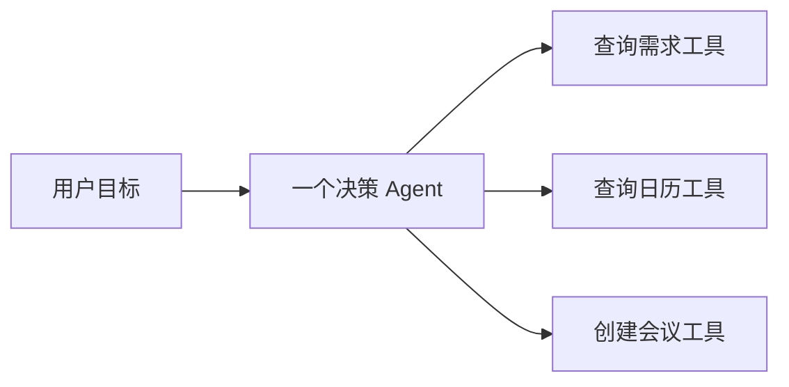
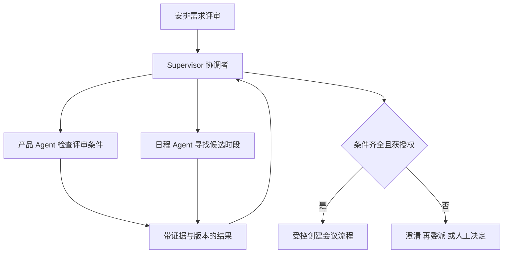

# 模块 05 · 第六讲：Multi-Agent 多智能体协作原理

[总目录](../../README.md) · [模块目录](../05-orchestration.md) · [下一讲：HITL](07-human-in-the-loop.md)

**来源**：[用户提供的课程分享对话](https://chatgpt.com/share/6aec9acb-f970-83ea-aca2-8fcaff04a9b5)，第六讲正文。本文按原课知识顺序重写，恢复案例、对比和面试问题；标注“补充解释”的部分为新整理。不是逐字转录，原互动控件不在 Markdown 中运行。

## 1. 这讲要解决什么问题

单个 Agent 已经能选择工具、查看结果、修改计划，为什么还要拆成多个 Agent？判断标准不应是“角色更多”，而是拆分后能否更好地管理专业知识、上下文、权限和任务责任。

贯穿案例是安排一次需求评审。查询四个人的共同空闲时间，可以交给确定性程序；但如果有人说“先确认接口范围，没有确定我就不参加”，任务就加入了条件判断、信息核验和协商。Multi-Agent 的可能价值出现在这些独立职责与动态协调中。

学完应能回答：什么才算多个 Agent，四种协作模式如何分辨，跨 Agent 应传什么，产生分歧由谁负责，以及怎样证明拆分有效。

## 2. 多个工具为什么不等于多个 Agent

一个 Agent 拥有目标、任务上下文、工具范围、状态和一定的行动选择能力。它不只是执行一次被指定的 API 调用，而可能根据观察决定下一步做什么。



这仍是单 Agent。查询日历工具按参数返回数据，不承担日程协调目标。若日程组件能自己判断缺少哪些条件、选择查询方法、请求补充，并对候选时段结果负责，它才具有子 Agent 的职责。

**补充解释：不要靠命名判断。** 一个函数叫 `FinanceAgent`，内部只有固定 SQL，也不一定有独立决策能力；一个普通命名的服务若具备独立目标与动态行动循环，可能承担 Agent 职责。这里讨论的是架构责任，不是统一的形式化分类标准。

## 3. 拆分的三个主要理由

### 3.1 专业能力分离

设备调查、订单管理、合同审核、财务查询所需规则差别很大。全部放进一个 Prompt，会增加工具选择和规则匹配难度。专业 Agent 可以只掌握本领域知识与工具，并由对应团队维护。

但专业拆分不能只看部门名称。若四个 Agent 实际读取相同资料、使用相同工具、没有独立完成条件，可能只是重复调用模型。

### 3.2 上下文隔离

合同分析不必读取设备传感器历史，设备调查也不必读取客户完整合同。每个子 Agent 只接收完成任务需要的信息，减少无关内容和意外泄露。

隔离有代价：子 Agent 可能不知道父 Agent 已掌握的事实，重复读取甚至得出不同结论。应通过明确的任务交接传递必要证据，而不是在“全部共享”和“完全不知道”之间二选一。

### 3.3 任务并行

多个无数据依赖的调查可以并行，潜在收益来自缩短关键路径。并行前仍需检查是否共享受限资源、是否存在配额及业务写冲突。

原课例子：需求查询 4 秒、日历查询 5 秒、会议室查询 3 秒。顺序理论耗时 12 秒；理想并行约 5 秒。实际为：

`T总 ≈ T分发 + max(T需求, T日历, T会议室) + T汇总`

**补充解释：**若分发和汇总又用掉 8 秒，总耗时约 13 秒，反而慢于原顺序例子。若业务规则要求先确认需求就绪才允许查询日历，那三步也不能按理想模型全部并行。公式建立在任务独立等假设上，不是实际性能保证。

## 4. 四种协作模式：看控制权

| 模式 | 谁负责下一步 | 结果通常交给谁 | 适合的任务 | 容易出现的问题 |
|---|---|---|---|---|
| Supervisor / Subagents | 中心协调者根据结果继续委派 | 协调者汇总 | 动态分解、跨领域调查 | 协调者成为瓶颈或误采纳结果 |
| Router | 路由规则或分类逻辑选择处理者 | 处理者或聚合层 | 边界清晰的请求分流 | 分类错、边界模糊时来回转发 |
| Handoff | 当前处理者将责任交给新处理者 | 新处理者接续任务或会话 | 服务阶段与角色切换 | 用户条件在交接时丢失 |
| Peer-to-Peer | 各主体在约定边界内协商 | 依契约确定 | 独立系统或组织协作 | 状态分歧、循环委派、责任不清 |

Supervisor 与 Router 的区别是持续协调责任。Router 可以一次分给多个处理者并聚合结果，并不限定为只选一个；Supervisor 则可能读取结果后再决定是否委派新工作。

Handoff 与“把子 Agent 当工具调用”也不同：后者通常由父 Agent 收回结果并继续负责，前者强调当前处理责任发生移交。具体实现仍需查看框架契约。



图表示职责关系；是否允许同时派出两项任务，要看评审就绪是否是查询日程的严格前置条件。

## 5. 完整案例：需求评审如何从目标变成业务结果

### 第一步：确认“需求就绪”意味着什么

产品 Agent 检查文档齐全、规则清楚、是否仍有阻塞项，返回 `ready`、`document_version` 与 `blocking_issues`。原课示例为文档 v1.4、无阻塞。

重要的是保留判断依据。`ready=true` 只是某个角色在某个版本下的判断，不能自动等价于所有评审前提都已满足。协调者还要知道评审标准由谁定义、该 Agent 是否有权作最终确认。

产品 Agent 不需要读取所有人的私人日历；日程 Agent 也不应为了找时间而拿到完整客户需求历史。

### 第二步：寻找共同空闲时段

| 角色 | 周二 14:00 | 周三 10:00 | 周四 16:00 |
|---|---|---|---|
| 产品 | 可参加 | 可参加 | 可参加 |
| 后端 | 可参加 | 不可参加 | 可参加 |
| 前端 | 可参加 | 可参加 | 不可参加 |
| 测试 | 可参加 | 可参加 | 可参加 |

周二 14:00 是候选交集，但还不能宣布安排成功。需要确认时长是否完整覆盖 60 分钟、会议室可用、时区一致、人员是否接受，以及是否有条件性约束。

**补充解释：**“空闲”“已邀请”“已接受”是不同状态，日历读结果与用户承诺也不同。不能把工具成功读取日历作为任务成功标准。

### 第三步：受控创建与核验

创建会议是业务写操作。系统核验权限、会议参数与必要确认后，使用幂等方式创建，取得会议标识并核验结果。通知是否成功、参会人是否接受，应根据业务定义分别记录。

若只是算交集加创建会议，普通 Workflow 加日历工具足够。只有需求检查、条件沟通和多轮协商确实需要独立能力时，才评估多个 Agent。

## 6. A2A 的四个核心对象

A2A 关注独立 Agent 的通信与互操作。本节是原课概念整理，字段格式与状态名称以目标版本规范为准。

| 对象 | 用途 | 会议案例 | 不应混淆 |
|---|---|---|---|
| Agent Card | 描述能力、入口、认证要求等发现信息 | 日程 Agent 的能力说明 | 能力声明不是授权凭证 |
| Task | 一项被委派的工作 | 寻找四人下周的共同时间 | 提交任务不等于任务完成 |
| Message | 任务过程中的沟通 | 是否允许午休时段 | 一条消息不必是最终产物 |
| Artifact | 任务输出产物 | 候选时间清单 | 返回产物还需业务核验 |

MCP 侧重 AI 应用与工具、资源等能力连接；A2A 侧重独立 Agent 的任务协作。两种协议能共同出现，也都不能凭协议名称自动解决组织间信任与业务授权。

## 7. 上下文交接：传任务契约

原课强调不能把整段聊天默认转发给所有 Agent。任务交接至少要包含目标、已确认事实及证据、约束、权限范围、截止时间或预算、输出要求和关联标识。

下面是**补充整理的业务契约示意，不是 A2A 协议报文，也不是可执行授权**：

```json
{
  "task_id": "schedule-review-001",
  "goal": "寻找需求评审会议候选时间",
  "constraints": {
    "duration_minutes": 60,
    "timezone": "Asia/Shanghai",
    "date_range": ["2026-11-09", "2026-11-15"],
    "participants": ["product", "backend", "frontend", "qa"]
  },
  "evidence": [{"document_version": "v1.4", "readiness_record": "review-014"}],
  "allowed_actions": ["READ_CALENDAR"],
  "expected_output": "candidate_slots_with_unresolved_conditions"
}
```

这里把“下周”解析为绝对日期，是补充解释：跨时区或延迟执行后相对时间可能改变。`allowed_actions` 只是任务约束说明，执行层仍需按真实身份校验，不能让调用方填一个字符串就获得权限。

保留证据与版本，可以防止下游把过期需求的“已就绪”用到新版本。如果必要事实发生变化，应使原结果失效或要求重新核验。

## 8. 多 Agent 分歧如何处理

产品 Agent 说材料已齐，研发 Agent 说接口未定，不一定是谁错了。前者可能检查文档完整性，后者检查技术准备度。

处理顺序是：先确认双方说的是不是同一条件，再检查证据与版本，接着按业务决策权确定谁能最终判断；无法消解的重要分歧转人工。

多数票不能自动产生真相，多个 Agent 也可能因为相同错误输入得出相同错误结论。任务中需要明确区分事实核验、偏好协商和授权决定。允许模型综合意见，不等于允许它授予自己业务决策权。

## 9. 怎样判断拆分有收益

原课要求以单 Agent 方案作基线，比较单 Agent 加必要工具、动态技能或工具发现、Supervisor 和 Router 等方案。保持任务范围、成功定义和资源预算可比，记录所有模型与工具成本。

| 指标 | 在本案例中怎么观察 |
|---|---|
| 端到端任务成功 | 是否在满足条件与授权后产生正确会议结果 |
| 子任务成功 | 日程、需求检查各自是否满足验收条件 |
| 交接准确性 | 任务是否交给合适处理者，关键约束是否保留 |
| 协调开销 | 分发、等待、结果转换、再次委派增加的时间与费用 |
| 上下文泄露 | 是否向无需要的 Agent 传递日历详情或客户资料 |
| 冲突解决 | 冲突时是否按证据与决策权处理 |
| 总 Token 与 P95 时长 | 包含父子 Agent 及重试，不能只算最后回答 |

**补充解释：**子任务成功率高并不保证总任务成功。各自找对日程和需求版本，但交接时版本混淆，仍会安排错会议。要检查组合后的业务结果。

## 10. 自测与解析

原课架构互动控件只显示了第一题，不能还原未显示的其余题。以下前 6 题整理自原课面试问答，第 7、8 题是新增纸上练习。

1. 一个 Agent 调用五个工具，是否算 Multi-Agent？
2. Router 一次分给多个 Agent，它就一定变成 Supervisor 吗？
3. Agent Card 写着“可创建会议”，是否足够授权创建？
4. 多个 Agent 共享完整 Memory 是否一定更好？
5. 多 Agent 意见冲突为什么不能简单投票？
6. 判断架构好坏应优先看什么？
7. 三个独立任务耗时 4、5、3 秒，分发 2 秒、汇总 4 秒，理想总耗时是多少？
8. 日程 Agent 找到共同时间，但产品 Agent 返回新阻塞项，能否直接创建会议？

<details>
<summary>展开答案与面试表达要点</summary>

1. 不算，关键看独立决策主体和职责，不看 API 数量。
2. 不一定，关键看是否持续按子任务反馈动态协调，而不是分发个数。
3. 不够，能力发现不等于身份认证、业务授权和参数确认。
4. 不一定，可能泄露信息和混入旧条件；应共享任务需要的事实及来源。
5. 可能标准不同、证据不同或权限不同，多数票无法解决这些差别。
6. 在可比任务上看业务成功率、成本、时延与边界合规，不看角色数量。
7. 约 `2 + max(4,5,3) + 4 = 11` 秒；忽略其他开销且假设无依赖、无排队。相对原 12 秒只节省 1 秒。
8. 不可。确认阻塞项是否影响评审条件，按业务负责人决定继续、澄清或重新准备。

面试可按“拆分理由 → 控制模式 → 任务契约 → 冲突处理 → 基线对比”组织回答。

</details>

## 11. 复习时应能画出的图

画出协调者、产品 Agent、日程 Agent、受控创建会议流程，标出每条边传什么。再回答：谁看到私人日历，谁决定需求就绪，谁可以创建会议，谁处理创建超时。只画角色框、不写责任与输入输出，还没有把这讲学透。

参考：[A2A 官方文档](https://a2a-protocol.org/latest/)、[Anthropic：Building Effective Agents](https://www.anthropic.com/research/building-effective-agents)。链接为继续阅读入口，不代表本笔记承诺任何 SDK 的具体版本行为。
