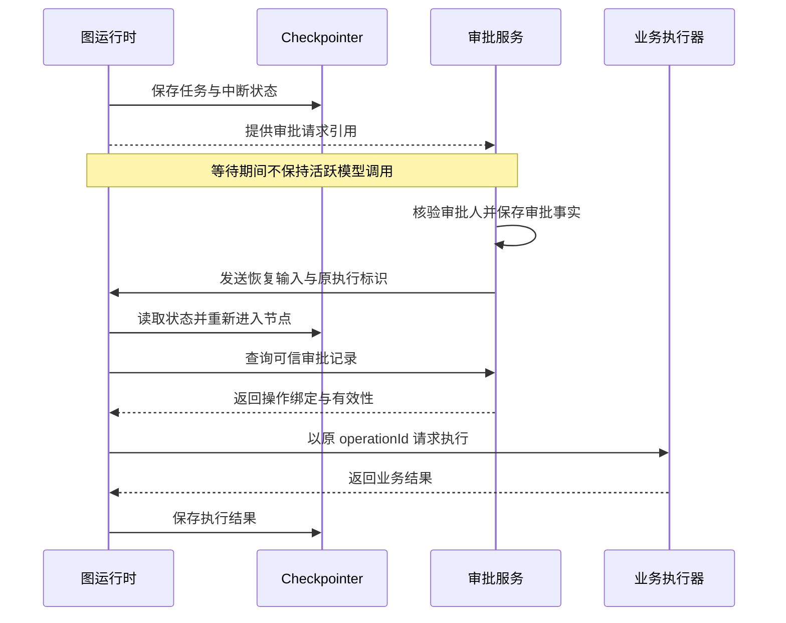

# 模块 05 · 第七讲：Human-in-the-loop 在 Agent 框架中的实现原理

[总目录](../../README.md) · [模块目录](../05-orchestration.md) · [上一讲：Multi-Agent](06-multi-agent.md) · [下一讲：框架选型](08-architecture-selection.md)

**来源**：[课程分享对话](https://chatgpt.com/share/6aec9acb-f970-83ea-aca2-8fcaff04a9b5)，第七讲正文与 5 道知识检验。本文为整理重写；新增时序解释和故障练习会明确标注。接口名称只用于理解语义，不是可运行示例。

## 1. 核心问题：三小时后的“继续”是什么

Supervisor 把维修任务交给 Repair Agent，后者发现需要主管批准。审批三小时后才完成。系统需要保证：审批前没有擅自建单、等待时不浪费持续执行资源、批准后能找到原任务、恢复时不重复写入，且旧批准不能用于不同操作。

这些问题分别涉及审批业务、持久化执行、任务关联和业务幂等。框架提供 Interrupt 与 Resume，只解决其中部分机制。

学完应能解释等待、Checkpoint、重放、审批事实和业务副作用的关系，并判断子 Agent 暂停如何影响父任务。

## 2. 三种等待，保存的东西不同

| 方式 | 等待时保留什么 | 如何继续 | 主要注意事项 |
|---|---|---|---|
| 同步阻塞 | 活跃调用及相应资源 | 原调用内得到结果 | 长时间等待占资源，进程故障可能失去现场 |
| 状态轮询 | 外部状态，由执行器定期查询 | 查到条件满足后调度 | 延迟、请求量和重复领取 |
| 持久化中断 | 持久化的任务状态与恢复标识 | 外部事件或恢复命令重新调度 | 状态可靠性、重放、重复事件 |

**补充解释：**轮询不必是一个线程一直 `sleep`。后台定时调度也能做到不占活跃请求；轮询与持久化状态甚至可以组合。真正要区分的是“依赖活着的内存执行现场”和“通过持久化事实重新调度”，不能简单说轮询必然不可靠。

持久化等待让任务在业务上继续存在，但执行进程可以停止。下次可能由另一台机器恢复，因此必须把必要状态保存在进程之外。

## 3. Interrupt、Checkpoint 与 Thread ID

在图执行中，Node 做工作，Edge 决定流向，State 保存数据。动态 `interrupt()` 表达“当前路径需要外部输入，暂时不能继续”。运行时借助持久化机制保存执行状态，并把中断信息交给外部调用方。

常见持久化用法需要配置 checkpointer，并以相同 `thread_id` 关联恢复。这里的 Thread ID 是图执行上下文标识，不是操作系统线程编号，也不天然等于登录用户 ID。

Checkpoint 保存了恢复需要的图状态，不是任意时间点的完整进程内存镜像。它也不自动把外部数据库写入和自己的状态保存合并成一个事务。[LangGraph 官方中断说明](https://docs.langchain.com/oss/python/langgraph/interrupts)

**补充解释：**仅接入内存型存储不能保证服务重启后恢复。生产是否持久、何时刷盘、如何隔离不同租户，是部署契约的一部分，不能从“用了 checkpointer”四个字推断全部可靠性。

## 4. Command(resume) 带回什么

审批完成后，外部应用用 `Command(resume=...)` 提供恢复值。运行时按原执行标识找到对应上下文，恢复值成为对应 `interrupt()` 的返回值。

原课给出类似 `approval_id`、`decision`、`approved_operation_id` 的业务数据。它只是告诉执行图“到哪里找这次审批”，不能代替真实审批凭证。



图为补充时序示意；业务审批通常也需要提前持久化申请与操作快照，具体提交与通知顺序应由实现确定，不应从图推导某种跨系统原子事务。

## 5. 恢复为什么会重新执行节点

这是原课最重要的反直觉点。可以用下面的概念伪代码理解，**不作为可直接运行的 SDK 示例**：

```text
ApprovalNode:
    draft = 插入新的维修草稿
    decision = interrupt(草稿信息)
    按 decision 决定后续流向
```

第一次进入节点，插入草稿，然后遇到中断。恢复时并非把旧调用栈的下一条指令接上，而是重新进入被中断节点，前面的插入草稿可能再次执行；再次到达对应中断调用时，它得到恢复值。

| 时点 | 发生的事 | 可能留下的记录 |
|---|---|---|
| 第一次运行 | 插入草稿，触发中断 | 草稿 D1 |
| 主管审批 | 批准 D1 的操作快照 | 审批 A1 |
| 恢复重进节点 | 再次插入草稿 | 新草稿 D2 |
| 继续执行 | 错把 A1 用到 D2 | 绑定关系错误或重复副作用 |

风险不只是多一条数据库记录，还可能让批准对象与真正执行对象不一致。

### 更清晰的拆分

`PrepareDraft → WaitApproval → Revalidate → Execute`

PrepareDraft 创建并保存稳定操作快照；WaitApproval 尽量只读取已有状态并等待；Revalidate 读取权威审批和当前业务条件；Execute 通过可信执行器实施幂等写入。

节点分开能缩小无意重放的范围，却不是 Exactly-once 保证。PrepareDraft 自己如果发生保存失败，也需要稳定标识或去重；不能认为“挪到前一个节点”就不再存在恢复风险。

## 6. 副作用成功、Checkpoint 未保存的窗口

**补充故障推演：**Execute 调用下游建单，下游创建成功，返回工单 T1；图运行时还没保存 T1 就崩溃。恢复后，图可能认为 Execute 没完成并再次执行。

如果再次生成新的 operationId，就可能创建 T2。正确方向是原任务使用稳定的业务 operationId，下游以该 ID 去重，并能查询既有结果。超时或崩溃后用同一标识核验，而不是猜测未执行。

| 机制 | 解决什么 | 不能单独解决什么 |
|---|---|---|
| Checkpoint | 知道执行进度并恢复 | 外部写入去重 |
| 业务幂等 | 同一业务操作重复请求不重复生效 | 图任务如何恢复 |
| 审批核验 | 当前操作是否获有效批准 | 下游是否曾执行成功 |
| 对账或结果查询 | 查明未知结果 | 自动赋予操作权限 |

## 7. 子 Agent 暂停，到底暂停谁

### 情况 A：作为父图中的同步子图

父节点调用维修子图，子图发生中断，等待会沿调用路径反映到父图。恢复时父节点中调用子图之前的逻辑也可能重新执行，因此父层副作用同样需要保护。

不能只检查子图是否幂等，而忽略父节点在调用前发送的通知或创建的业务记录。

### 情况 B：独立任务服务

Supervisor 提交 Repair Task 后保存子任务 ID，将自身状态置为业务上的 `WAITING_SUBTASK`；Repair Task 进入 `WAITING_APPROVAL`。审批完成后维修任务继续，最后通过状态同步或事件通知父任务。

这两个名称是业务示意状态，不是强制的 A2A 协议枚举。父任务不需要开线程持续等待，但应知道子任务超时、失败、取消如何传播。

### 情况 C：还有其他并行分支

库存查询、排班查询可能与审批等待独立，是否能继续取决于图依赖、运行时调度与汇合规则。单条路径等待不等于整个服务停止，也不能直接断言其他分支必然继续。

**补充解释：**判断时先画依赖图，再问恢复作用域。不能从“使用了 Supervisor”这个角色名称推出具体暂停行为。

## 8. 审批事实为什么不能只放在 Graph State

模型能生成 `approval_status=APPROVED`，但它不能凭生成文本证明“谁批准了什么”。外部传入相同字段也不够，必须验证调用身份与记录真实性。

| 业务审批服务维护 | 图状态维护 |
|---|---|
| 审批人、角色与身份验证结果 | taskId 与 approvalId 引用 |
| 被批准操作及参数版本 | 当前节点与等待状态 |
| 批准、拒绝、撤销、过期事实 | 最近一次核验及执行结果引用 |
| 有效期与审计记录 | 图执行版本与恢复关联信息 |

恢复后核验：审批是否存在，审批人是否有权限，是否绑定当前 operationId 和参数版本，是否过期或撤销，任务是否已取消，当前业务条件是否仍允许执行。

这也让审批入口与图解耦：后台、企业内部审批应用等渠道可以变，可信审批契约保持一致。原课列举渠道只是架构示例，不表示已经验证某平台具有全部所需消息能力。

## 9. 多个中断与工作流升级

同一节点内连续询问“建单、费用、人员”时，常见恢复匹配涉及中断顺序。若升级后调整顺序或让分支跳过一次中断，恢复值可能对应错误位置。原课建议将关键业务确认拆成独立节点或状态，分别绑定审批标识。

图从 `A → B → C` 改为 `A → D → B → C`，旧任务可能仍暂停在 B。升级前要检查节点、State Schema、工具参数及审批契约。不能默认历史任务自动适配新图。

**补充解释：**可以考虑旧任务继续使用旧定义、显式迁移或受控终止后重建等策略，但它们各有代价，须按实际运行时支持选择。笔记不将其中一种写成框架默认行为。

## 10. 边界故障清单

| 情况 | 风险 | 需要明确的处理 |
|---|---|---|
| 同一审批回调到两次 | 同时唤醒同一任务 | 事件去重、任务领取控制、业务幂等 |
| 批准后价格改变 | 旧确认执行新参数 | 参数快照绑定，按策略重新批准 |
| 用户取消与批准同时发生 | 取消后仍写入 | 定义状态优先级、原子状态检查与竞态处理 |
| 子任务失败但父任务未获通知 | 无限等待 | 超时、状态核验、对账或可靠事件 |
| 长期任务恢复时权限已撤销 | 越权继续 | 恢复与执行前重新校验 |
| 建单成功但通知失败 | 被误判整体未执行 | 区分业务结果与通知结果，通知单独重试 |

HITL 的位置由业务风险和授权策略决定。低风险已授权读取可以自动执行；高影响写操作可能需要确认或严格审批。不能把原课风险示例理解为每次建单一律需要新审批，也不能把审批当作每轮模型思考的必经步骤。

## 11. 原课 5 道知识检验与解析

原题交互已改为静态问答，保留原题考点。

1. `interrupt()` 主要解决什么？
2. 为什么要特别检查中断前的代码？
3. 独立子 Agent 通过 A2A 等待审批，Supervisor 应怎样等待？
4. Graph State 中写着 `APPROVED` 是否足够授权建单？
5. 暂停期间部署新图，恢复应检查什么？

<details>
<summary>展开答案</summary>

1. 保存可恢复的执行状态并等待外部输入，不是暂停模型训练，也不保证业务事务 Exactly-once。
2. 恢复可能重进节点，中断前副作用可能再次发生。
3. 保存子任务关联与等待状态，完成后恢复协调；不阻塞三小时，也不不断创建新子任务。
4. 不够，查可信审批服务，核验身份、操作、参数版本及当前业务状态。
5. 节点、State Schema、工具及审批契约的兼容；Temperature 与此无关。

</details>

## 12. 新增自测：审批与执行竞态

题目：维修任务等待审批，主管批准时用户同时取消。执行器已经收到恢复命令，但尚未建单。你会查什么？

参考思路：首先明确取消与批准的业务状态规则，在可信任务记录上核验当前终态和操作版本；恢复输入不能覆盖已取消事实。执行前防止状态检查与写入之间的竞态，依赖业务原子操作或执行契约。若工单其实已创建，进入明确的取消或补偿流程，而不是删除图状态装作没发生。

面试回答主线：**保存等待状态 → 原标识恢复 → 允许节点重放 → 可信审批核验 → 幂等执行与结果核验**。这五步分别解决不同问题，缺一不能用另一步替代。
