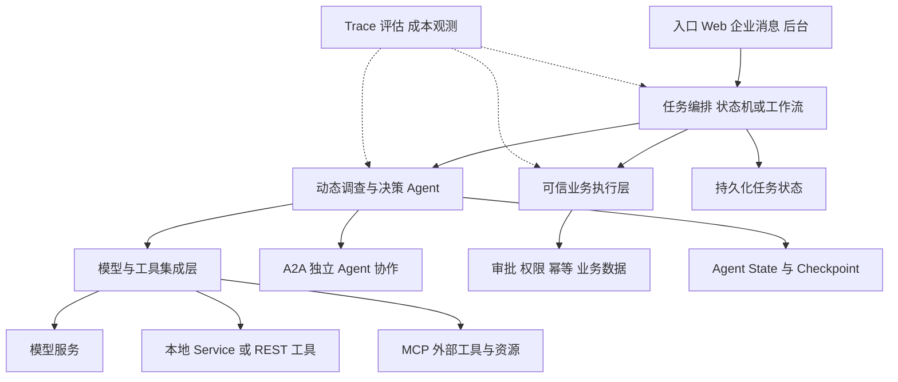
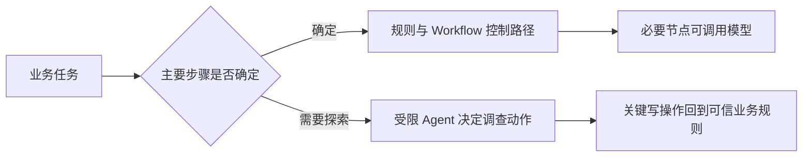

# 模块 05 · 第八讲：Agent 技术架构全景与框架选型

[总目录](../../README.md) · [模块目录](../05-orchestration.md) · [上一讲：HITL](07-human-in-the-loop.md)

**来源**：[课程分享对话](https://chatgpt.com/share/6aec9acb-f970-83ea-aca2-8fcaff04a9b5)，第八讲正文、模块课程表与 5 道知识检验。本文为重写整理，含标注的补充说明。企业消息案例是架构讨论，不是项目已实现清单，也不代表对平台接入能力的最新核验。

## 1. 选型首先要能说清责任

“Spring AI、LangGraph、MCP、A2A 选哪个”往往把不同层次混在一起。Spring AI 提供应用中的 AI 能力集成，图编排管理执行与状态，协议定义连接边界，业务系统定义什么行为可以发生。

框架可以提供机制，不能自动知道某订单能否退款、某人能否重启设备。回答架构题时应从业务任务出发，再解释组件为何必要。

学完应能用四个独立问题判断架构：步骤是否确定，任务是否跨请求恢复，工具是否需标准化复用，是否有独立 Agent 需要协作。

## 2. 架构全景：逻辑层次不是强制部署图

图只表达可组合职责，不要求全部组件都出现。Spring AI 可以独立完成很多 AI 应用；LangGraph 也能直接集成模型与工具；Java 团队还可选其他编排实现或已有工作流引擎。不能从逻辑图推导“Spring AI 必须经网络调用 LangGraph”。

## 3. 五类技术，各自补哪一块

| 技术或能力 | 主要职责 | 单独采用时仍需应用处理 |
|---|---|---|
| Spring AI | Java / Spring 场景的模型交互与 AI 能力集成 | 业务授权、流程契约、跨系统幂等 |
| LangGraph 等图运行时 | 显式状态、节点、路由、循环及恢复机制 | 外部业务副作用、可信审批事实 |
| MCP | AI 应用与外部工具、资源等能力的标准化连接 | 工具业务语义、权限与正确性 |
| A2A | 独立 Agent 的通信与任务互操作 | 任务的业务验收、信任和组织权责 |
| Workflow Engine | 显式流程、等待、调度、重试与恢复 | 通过集成提供语义分析等模型能力 |

**补充解释：**这些职责有重叠，工作流引擎也能集成 Agent，集成框架也可能提供一定编排能力。因此表格用于定位，不是说某技术绝不能做另一类工作。按目标版本的机制、维护成本与业务约束比较，避免只按产品标签判断。

概念定位可查：[Spring AI ChatClient](https://docs.spring.io/spring-ai/reference/api/chatclient.html)、[LangGraph Overview](https://docs.langchain.com/oss/python/langgraph/overview)、[MCP](https://modelcontextprotocol.io/docs/getting-started/intro)、[A2A](https://a2a-protocol.org/latest/)。本文不提供版本兼容矩阵或可运行 API 契约。

## 4. 第一维：步骤是否能提前确定

固定报销流程可按校验票据、检查金额、主管审批、入账来实现。其中调用模型识别票据，不意味着要让模型自己决定能不能跳过审批。

设备故障调查不同：开始时未必知道该查日志、指标、维修记录还是知识库，下一步取决于观察结果。这里可以使用 ReAct 或计划执行机制。

现实常是混合方案：Workflow 管总体任务生命周期，Agent 处理某个不确定节点。能动态查资料，不等于必须动态控制授权与事务。

**补充解释：**将 LLM 从业务主控位置移到调查节点，不是降低其价值，而是让开放语义能力与确定性规则分别承担适合的工作。是否需要 Agent 的依据是行动选择需求，而非“任务听起来复杂”。

## 5. 第二维：任务需要活多久

任务复杂度和持续时间是两个独立维度。十秒完成的调查可能需要多轮决策；两天后才批准的简单报销，可能完全不需要自主 Agent，却必须持久化等待。

| | 一次请求内完成 | 跨请求或长时间等待 |
|---|---|---|
| 路径固定 | 普通业务函数或短 Workflow | 持久化任务与审批流程 |
| 路径动态 | 有预算的 Agent 工具循环 | 持久化 Agent 编排，并与业务状态协作 |

对应能力逐步增加：单次总结只需模型交互；多轮查询需要工具循环；复杂分支与循环可能需要图；跨进程恢复需要持久化状态；跨系统写入还要幂等、结果核验与补偿。

有消息队列不等于完整任务恢复，有 Checkpoint 也不等于外部动作只生效一次。必须明确保存边界和故障窗口。

## 6. 第三维：是否需要多个决策主体

原课推荐从最简单方案开始：单次模型调用、单 Agent 加工具、Agent 加 Workflow，再评估 Multi-Agent。它不是机械升级阶梯，每个项目都不必走完。

值得拆分的理由包括专业上下文隔离、可验证的并行收益、独立团队维护和跨组织协作。若单 Agent 的实际评估显示工具选择混乱，可以先试动态工具选择或改善上下文，再比较是否拆分。

原课反例是查询一个设备是否在线。如果架构变成 Supervisor → Device Agent → IoT Agent → Status Agent → 查询 API，多层模型决策既没有增加所需信息，又放大延迟和错误传播。直接授权查询工具更清晰。

评价多 Agent 应覆盖端到端任务成功、总体成本和尾延迟，而不是只报告“使用了四个专家角色”。

## 7. 第四维：协议边界在哪里

### MCP：工具能力是否需要标准化复用

多个 AI 应用需要使用同一套设备能力、工具由多个团队维护，或需要统一发现和连接时，可以考虑 MCP。当前 Java 应用内部已有受控 Service，直接调用可能更简单。

MCP 不要求把公司所有 REST API 替换掉，也不意味着绕过网关、认证或业务服务。关键是新增标准化接入是否带来足够复用收益。

### A2A：是否存在独立 Agent 系统

另一团队独立部署维修调度 Agent，需要跨系统委派、交换状态和产物，可以考虑 A2A。同一图里的两个计算节点，不必为了互相传变量引入跨 Agent 协议。

**补充解释：**跨系统是引入标准协议的理由之一，不是无条件选择结论。已有 API 或任务契约能满足需求时，还要比较生态兼容、认证、运维与迁移成本。协议不授予信任，能力发现不代表可执行授权。

## 8. 完整案例：企业消息驱动的设备调查与工单

### 8.1 先把目标说完整

场景是客户发送文字、语音或图片，请求查询设备、调查故障、必要时创建工单并获得反馈。

原课把消息接入、去重、审批、建单和反馈归入确定性流程，把依据观察动态调查归入 Agent。平台是否允许某种群消息接入与回传，需要独立核实；这里仅分析收到合法输入之后的职责。

### 8.2 主流程按业务事实前进

入口产生唯一消息关联，媒体解析后创建业务任务。规则或模型分类将任务交给查询或调查处理。调查得出建议不意味着自动获准建单；受控执行层检查授权、必要审批和当前状态，再创建并核验结果。

| 阶段 | 输出 | 完成标准举例 |
|---|---|---|
| 接入与去重 | 可关联的业务任务 | 同一来源消息不会重复触发业务效果 |
| 输入理解 | 意图与对象信息 | 无法确定设备时进入澄清 |
| 动态调查 | 证据、判断与未确定项 | 结论可追溯，不伪造查询结果 |
| 准备动作 | 待执行操作快照 | 参数完整，并绑定对象与版本 |
| 授权与执行 | 已核验的操作结果 | 有真实工单 ID 和结果状态 |
| 反馈 | 交付或通知状态 | 与业务完成分别记录，可处理失败 |

### 8.3 两类状态分开

业务任务状态可以是 `RECEIVED → INVESTIGATING → WAITING_APPROVAL → EXECUTING → COMPLETED`，这是原课业务示意，不是通用协议枚举。另需按实际流程设计拒绝、失败、取消、结果未知等路径。

Agent 内部状态保存计划、观察、待调用工具和调查结果。它服务于执行过程，但不应直接覆盖业务权威事实。

例如模型认为“可以建单”只能形成建议；业务状态是否进入 EXECUTING，要取决于可信规则。模型认为“已建单”也不能替代下游真实工单标识。

### 8.4 图运行时放在哪里

若调查涉及循环，可以用图表达 `Analyze → SelectTool → ExecuteTool → Observe`，证据不足再回到 Analyze。设置总时限、调用次数和无进展停止条件。

若企业已有审批引擎，可以让图运行时只管调查，已有引擎管理审批和写入，不必为了引入 AI 重做权限、消息和审批设施。

若选 Python 图服务与 Java 业务服务，跨语言调用会新增部署、鉴权、序列化和故障边界。**补充解释：**这些维护成本要与图机制的收益一起比较，不能只说“生态流行所以值得”。

## 9. 框架选型还要问团队什么

原课强调技术栈、维护复杂度、可靠性与既有系统复用。可以把讨论具体化为以下问题：

- 团队能否调试运行时状态，而不只是能跑通演示？
- 状态存储、队列、审批和观测平台能否复用？
- 历史任务升级时由谁负责兼容？
- 工具超时后谁确定是否产生副作用？
- 运行成本增加后，哪些任务仍有足够业务收益？

这些问题的答案会影响最终组合。Java 背景让 Spring 集成具有便利，但不能由语言单独决定全部架构。新增服务数量、学习和运维成本同样重要。

## 10. 面试系统设计：七步回答法

1. **识别业务任务**：输入类型、目标、时效、数据边界与完成标准。
2. **拆确定与不确定部分**：固定授权和写入流程、动态调查分别处理。
3. **选模型集成方式**：按团队和能力要求说明为何用某种客户端或框架。
4. **判断编排需求**：循环、分支、等待、恢复分别需要什么机制。
5. **设计工具边界**：最小权限、业务校验、服务职责及是否需要协议复用。
6. **处理可靠性与安全**：消息去重、审批、幂等、超时、注入、取消和审计。
7. **定义验证方法**：业务成功率、错误类型、成本、延迟和对照基线。

**补充示范口述：**“我先区分查询、调查和写操作。固定查询直接调用授权业务工具，故障调查由有预算的 Agent 选择信息源。长审批保存在任务系统，恢复时核验操作版本。Java 服务负责可信业务规则，是否增加图运行时取决于循环和恢复复杂度；只有工具跨应用复用或与独立 Agent 协作时，再分别评估 MCP 与 A2A。最后用真实任务集比较成功率、延迟和成本。”

这是可学习的回答结构，不应当作已实施经历背诵。若没有上线项目，应明确说是设计推演。

## 11. 原课综合知识检验与解析

1. 固定规则识别发票、审批、入账，应优先采用什么？
2. 故障调查需要工具循环并等待人工审批，重点考虑什么？
3. 多套 AI 应用要复用设备工具，什么协议值得考虑？
4. 独立团队的 Agent 跨系统委派，什么协议更直接相关？
5. 使用 Checkpoint 是否自动保证工单不重复？

展开答案

1. 确定性 Workflow，在必要节点调用模型；不让 ReAct 自主决定全部审批路径。
2. 具备状态持久化的 Agent 编排，与可信审批和业务执行机制配合。
3. MCP；仍需认证授权与业务执行控制，不等于替换全部普通 API。
4. A2A；不等于自动解决业务验收或组织授权。
5. 否。业务幂等和结果核验仍然必要；单纯加一个普通数据库索引也不能保证完整业务语义。

## 12. 新增练习：相同框架能否服务不同架构

给两项任务选能力：A 是一次性总结技术文档，B 是调查设备、等两天审批后建单。它们能否使用同一个模型客户端？能。是否因此需要相同的执行系统？不需要。A 的重点是输入与摘要质量；B 还需要持久化任务、恢复关联、审批、幂等和结果核验。

再将 B 的故障调查替换为固定阈值规则。任务仍需等待两天，持久化执行依然必要，但 Agent 的需求可能消失。这说明“不确定性”与“生命周期”必须分别判断。

本讲复习的达标点是：不先列框架名，也能讲清谁决定下一步、状态放哪里、如何恢复、谁有权执行、怎么证明结果正确。之后再把适合的工具放到这些职责上。
